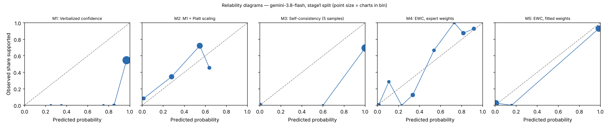

# EWC pilot report — gemini-3.8-flash (gemini), stage1 split

Generated 2026-10-27T22:16:32. Charts: 85.

## Calibration and discrimination — All charts

| Method | n | ECE (95% CI) | Brier | AUROC (95% CI) | Coverage at precision ≥ 0.95 |
|---|---|---|---|---|---|
| M1 Verbalized confidence | 85 | 0.458 (0.357–0.560) | 0.441 | 0.692 (0.584–0.793) | 0.00 |
| M2 M1 + Platt scaling | 85 | 0.128 (0.054–0.220) | 0.216 | 0.692 (0.584–0.793) | 0.00 |
| M3 Self-consistency (5 samples) | 85 | 0.219 (0.136–0.306) | 0.216 | 0.795 (0.721–0.868) | 0.00 |
| M4 EWC, expert weights | 85 | 0.099 (0.065–0.172) | 0.111 | 0.924 (0.861–0.975) | 0.00 |
| M5 EWC, fitted weights | 85 | 0.043 (0.014–0.096) | 0.047 | 0.966 (0.920–0.995) | 0.28 |
| M7 Ablation: no quote verification | 85 | 0.043 (0.014–0.096) | 0.047 | 0.966 (0.920–0.995) | 0.28 |
| M8 Ablation: two-way answers | 85 | 0.101 (0.055–0.162) | 0.089 | 0.937 (0.879–0.984) | 0.24 |

## Calibration and discrimination — Excluding charts flagged label_needs_review

| Method | n | ECE (95% CI) | Brier | AUROC (95% CI) | Coverage at precision ≥ 0.95 |
|---|---|---|---|---|---|
| M1 Verbalized confidence | 73 | 0.375 (0.266–0.484) | 0.360 | 0.731 (0.603–0.845) | 0.00 |
| M2 M1 + Platt scaling | 73 | 0.185 (0.108–0.287) | 0.217 | 0.731 (0.603–0.845) | 0.00 |
| M3 Self-consistency (5 samples) | 73 | 0.090 (0.027–0.159) | 0.087 | 0.906 (0.833–0.971) | 0.00 |
| M4 EWC, expert weights | 73 | 0.126 (0.084–0.188) | 0.096 | 0.950 (0.892–0.991) | 0.18 |
| M5 EWC, fitted weights | 73 | 0.031 (0.008–0.084) | 0.040 | 0.979 (0.948–1.000) | 0.58 |
| M7 Ablation: no quote verification | 73 | 0.031 (0.008–0.084) | 0.040 | 0.979 (0.948–1.000) | 0.58 |
| M8 Ablation: two-way answers | 73 | 0.102 (0.049–0.165) | 0.089 | 0.947 (0.890–0.988) | 0.26 |

## Decisions at operating thresholds (all charts)

Auto-accept threshold: the lowest score giving precision ≥ 0.95 on dev, applied unchanged to test. F0.5 weights precision over recall. Charts flagged for review are never auto-accepted.

| Method | Threshold | Precision | Recall | F0.5 | Accepted | Precision at 0.5 | Recall at 0.5 | F0.5 at 0.5 |
|---|---|---|---|---|---|---|---|---|
| M1 | 1.000 | n/a | 0.000 | 0.000 | 0.00 | 0.494 | 1.000 | 0.550 |
| M2 | 0.699 | n/a | 0.000 | 0.000 | 0.00 | 0.660 | 0.756 | 0.677 |
| M3 | n/a | n/a | 0.000 | n/a | 0.00 | 0.683 | 1.000 | 0.730 |
| M4 | 0.550 | 0.917 | 0.805 | 0.892 | 0.42 | 0.860 | 0.902 | 0.869 |
| M5 | 0.183 | 0.930 | 0.976 | 0.939 | 0.51 | 0.930 | 0.976 | 0.939 |
| M7 | 0.183 | 0.930 | 0.976 | 0.939 | 0.51 | 0.930 | 0.976 | 0.939 |
| M8 | 0.978 | 0.950 | 0.463 | 0.785 | 0.24 | 0.881 | 0.902 | 0.885 |

## Extraction quality against intended answers

After verification. Plain agreement is shown for reference only; answer types are imbalanced.

| Question | Macro-F1 | Recall yes | Recall no | Recall not documented | Precision yes | Precision no | Agreement | Macro-F1 before verification | n |
|---|---|---|---|---|---|---|---|---|---|
| G1 | 0.900 | 1.000 (79) | 0.667 (6) | n/a (0) | 1.000 | 1.000 | 0.976 | 0.900 | 85 |
| G2 | 1.000 | 1.000 (77) | 1.000 (6) | n/a (0) | 1.000 | 1.000 | 1.000 | 1.000 | 83 |
| Q1 | 1.000 | 1.000 (70) | n/a (0) | 1.000 (15) | 1.000 | n/a | 1.000 | 1.000 | 85 |
| Q2 | 1.000 | 1.000 (58) | 1.000 (6) | 1.000 (20) | 1.000 | 1.000 | 1.000 | 1.000 | 84 |
| Q3 | 1.000 | 1.000 (22) | 1.000 (2) | 1.000 (56) | 1.000 | 1.000 | 1.000 | 1.000 | 80 |
| Q4 | 0.980 | 1.000 (40) | n/a (0) | 0.944 (18) | 0.976 | n/a | 0.983 | 0.980 | 58 |

Recall columns show the number of intended answers of that type in parentheses.

Confusion matrices (rows = intended answer, columns = model answer after verification):

**G1**

| intended \ model | yes | no | not documented |
|---|---|---|---|
| yes | 79 | 0 | 0 |
| no | 0 | 4 | 2 |
| not_documented | 0 | 0 | 0 |

**G2**

| intended \ model | yes | no | not documented |
|---|---|---|---|
| yes | 77 | 0 | 0 |
| no | 0 | 6 | 0 |
| not_documented | 0 | 0 | 0 |

**Q1**

| intended \ model | yes | no | not documented |
|---|---|---|---|
| yes | 70 | 0 | 0 |
| no | 0 | 0 | 0 |
| not_documented | 0 | 0 | 15 |

**Q2**

| intended \ model | yes | no | not documented |
|---|---|---|---|
| yes | 58 | 0 | 0 |
| no | 0 | 6 | 0 |
| not_documented | 0 | 0 | 20 |

**Q3**

| intended \ model | yes | no | not documented |
|---|---|---|---|
| yes | 22 | 0 | 0 |
| no | 0 | 2 | 0 |
| not_documented | 0 | 0 | 56 |

**Q4**

| intended \ model | yes | no | not documented |
|---|---|---|---|
| yes | 40 | 0 | 0 |
| no | 0 | 0 | 0 |
| not_documented | 1 | 0 | 17 |

Ambiguous fields (two answers defensible), reported separately:

- G2: agreement 1.000, macro-F1 1.000 (n = 2)
- Q2: agreement 1.000, macro-F1 1.000 (n = 1)
- Q3: agreement 1.000, macro-F1 1.000 (n = 5)
- Q4: agreement 0.741, macro-F1 0.735 (n = 27)

## Faithfulness, review flags and reproducibility

- Yes/no answers whose quote failed verification: 0.000
- By question: G1 0.000 (0 of 83); G2 0.000 (0 of 83); Q1 0.000 (0 of 70); Q2 0.000 (0 of 64); Q3 0.000 (0 of 29); Q4 0.000 (0 of 55)
- Charts flagged for human review by the verification rule: 0
- Unparseable responses: 0
- Median per-chart score SD across extraction runs, M5: 0.000 (n = 85)
- Median per-chart SD of verbalized confidence across runs, M1: 0.005 (n = 85)

## Fitted weights (M5, fitted on dev)

| Feature | Weight |
|---|---|
| intercept | -5.724 |
| Q1_yes | 1.573 |
| Q1_no | 0.000 |
| Q2_yes | -0.039 |
| Q2_no | 0.000 |
| Q3_yes | 2.494 |
| Q3_no | -7.988 |
| Q4_yes | 8.174 |
| Q4_no | 0.000 |

C = 31.622776601683793; grid extended: False; still at grid edge: False; training charts: 101 (62 positive).

## Pre-registered checks

| Check | Result |
|---|---|
| H1 macro-F1 >= 0.90 and 'no' recall >= 0.90 on every question | False |
| H2 quote failures <= 5% | True |
| H3 M5 median SD <= 0.05 and below M1 | True |
| H4 M5 AUROC >= M2 AUROC - 0.02 and M5 ECE <= M2 ECE | True |
| H5 M5 beats each of M6, M7, M8 on ECE or AUROC | {'M6': False, 'M7': False, 'M8': True} |
| Kill criterion: M5 worse than M2 on both AUROC and ECE | not triggered |
| Kill criterion: a gate question below 0.90 macro-F1 or 'no' recall | TRIGGERED |

## Usage

850 extraction and verbal calls; 1,289,510 input tokens, 1,008,215 output tokens (M6 calls not included).
