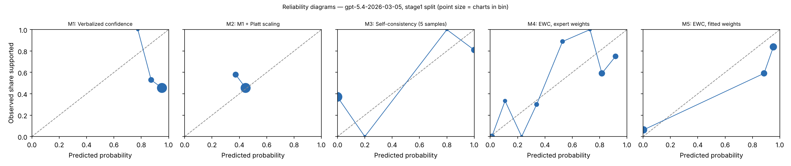

# EWC pilot report — gpt-5.4-2026-03-05 (gpt), stage1 split

Generated 2026-10-27T22:13:49. Charts: 85.

## Calibration and discrimination — All charts

| Method | n | ECE (95% CI) | Brier | AUROC (95% CI) | Coverage at precision ≥ 0.95 |
|---|---|---|---|---|---|
| M1 Verbalized confidence | 85 | 0.460 (0.355–0.564) | 0.458 | 0.471 (0.349–0.603) | 0.00 |
| M2 M1 + Platt scaling | 85 | 0.053 (0.021–0.166) | 0.258 | 0.471 (0.349–0.603) | 0.00 |
| M3 Self-consistency (5 samples) | 85 | 0.322 (0.226–0.419) | 0.319 | 0.667 (0.575–0.757) | 0.00 |
| M4 EWC, expert weights | 85 | 0.163 (0.097–0.254) | 0.188 | 0.791 (0.693–0.885) | 0.00 |
| M5 EWC, fitted weights | 85 | 0.140 (0.067–0.224) | 0.160 | 0.883 (0.805–0.940) | 0.07 |
| M7 Ablation: no quote verification | 85 | 0.140 (0.067–0.224) | 0.160 | 0.883 (0.805–0.940) | 0.07 |
| M8 Ablation: two-way answers | 85 | 0.066 (0.028–0.151) | 0.152 | 0.861 (0.779–0.929) | 0.06 |

## Calibration and discrimination — Excluding charts flagged label_needs_review

| Method | n | ECE (95% CI) | Brier | AUROC (95% CI) | Coverage at precision ≥ 0.95 |
|---|---|---|---|---|---|
| M1 Verbalized confidence | 73 | 0.381 (0.266–0.497) | 0.389 | 0.470 (0.334–0.603) | 0.00 |
| M2 M1 + Platt scaling | 73 | 0.133 (0.036–0.254) | 0.269 | 0.470 (0.334–0.603) | 0.00 |
| M3 Self-consistency (5 samples) | 73 | 0.321 (0.222–0.427) | 0.316 | 0.711 (0.628–0.791) | 0.25 |
| M4 EWC, expert weights | 73 | 0.124 (0.081–0.209) | 0.133 | 0.893 (0.809–0.964) | 0.16 |
| M5 EWC, fitted weights | 73 | 0.068 (0.022–0.144) | 0.098 | 0.932 (0.869–0.982) | 0.37 |
| M7 Ablation: no quote verification | 73 | 0.068 (0.022–0.144) | 0.098 | 0.932 (0.869–0.982) | 0.37 |
| M8 Ablation: two-way answers | 73 | 0.090 (0.033–0.162) | 0.111 | 0.929 (0.875–0.973) | 0.37 |

## Decisions at operating thresholds (all charts)

Auto-accept threshold: the lowest score giving precision ≥ 0.95 on dev, applied unchanged to test. F0.5 weights precision over recall. Charts flagged for review are never auto-accepted.

| Method | Threshold | Precision | Recall | F0.5 | Accepted | Precision at 0.5 | Recall at 0.5 | F0.5 at 0.5 |
|---|---|---|---|---|---|---|---|---|
| M1 | n/a | n/a | 0.000 | n/a | 0.00 | 0.482 | 1.000 | 0.538 |
| M2 | n/a | n/a | 0.000 | n/a | 0.00 | n/a | 0.000 | 0.000 |
| M3 | n/a | n/a | 0.000 | n/a | 0.00 | 0.818 | 0.439 | 0.698 |
| M4 | n/a | n/a | 0.000 | n/a | 0.00 | 0.720 | 0.878 | 0.747 |
| M5 | 0.988 | 0.923 | 0.293 | 0.645 | 0.15 | 0.736 | 0.951 | 0.771 |
| M7 | 0.988 | 0.923 | 0.293 | 0.645 | 0.15 | 0.736 | 0.951 | 0.771 |
| M8 | 0.913 | 0.818 | 0.439 | 0.698 | 0.26 | 0.709 | 0.951 | 0.747 |

## Extraction quality against intended answers

After verification. Plain agreement is shown for reference only; answer types are imbalanced.

| Question | Macro-F1 | Recall yes | Recall no | Recall not documented | Precision yes | Precision no | Agreement | Macro-F1 before verification | n |
|---|---|---|---|---|---|---|---|---|---|
| G1 | 0.951 | 1.000 (79) | 0.833 (6) | n/a (0) | 0.988 | 1.000 | 0.988 | 0.951 | 85 |
| G2 | 1.000 | 1.000 (77) | 1.000 (6) | n/a (0) | 1.000 | 1.000 | 1.000 | 1.000 | 83 |
| Q1 | 1.000 | 1.000 (70) | n/a (0) | 1.000 (15) | 1.000 | n/a | 1.000 | 1.000 | 85 |
| Q2 | 0.901 | 0.966 (58) | 1.000 (6) | 0.850 (20) | 0.982 | 0.750 | 0.940 | 0.901 | 84 |
| Q3 | 0.978 | 0.909 (22) | 1.000 (2) | 1.000 (56) | 1.000 | 1.000 | 0.975 | 0.978 | 80 |
| Q4 | 0.839 | 1.000 (40) | n/a (0) | 0.611 (18) | 0.851 | n/a | 0.879 | 0.839 | 58 |

Recall columns show the number of intended answers of that type in parentheses.

Confusion matrices (rows = intended answer, columns = model answer after verification):

**G1**

| intended \ model | yes | no | not documented |
|---|---|---|---|
| yes | 79 | 0 | 0 |
| no | 1 | 5 | 0 |
| not_documented | 0 | 0 | 0 |

**G2**

| intended \ model | yes | no | not documented |
|---|---|---|---|
| yes | 77 | 0 | 0 |
| no | 0 | 6 | 0 |
| not_documented | 0 | 0 | 0 |

**Q1**

| intended \ model | yes | no | not documented |
|---|---|---|---|
| yes | 70 | 0 | 0 |
| no | 0 | 0 | 0 |
| not_documented | 0 | 0 | 15 |

**Q2**

| intended \ model | yes | no | not documented |
|---|---|---|---|
| yes | 56 | 0 | 2 |
| no | 0 | 6 | 0 |
| not_documented | 1 | 2 | 17 |

**Q3**

| intended \ model | yes | no | not documented |
|---|---|---|---|
| yes | 20 | 0 | 2 |
| no | 0 | 2 | 0 |
| not_documented | 0 | 0 | 56 |

**Q4**

| intended \ model | yes | no | not documented |
|---|---|---|---|
| yes | 40 | 0 | 0 |
| no | 0 | 0 | 0 |
| not_documented | 7 | 0 | 11 |

Ambiguous fields (two answers defensible), reported separately:

- G2: agreement 1.000, macro-F1 1.000 (n = 2)
- Q2: agreement 0.000, macro-F1 0.000 (n = 1)
- Q3: agreement 1.000, macro-F1 1.000 (n = 5)
- Q4: agreement 0.593, macro-F1 0.590 (n = 27)

## Faithfulness, review flags and reproducibility

- Yes/no answers whose quote failed verification: 0.000
- By question: G1 0.000 (0 of 85); G2 0.000 (0 of 83); Q1 0.000 (0 of 70); Q2 0.000 (0 of 66); Q3 0.000 (0 of 27); Q4 0.000 (0 of 63)
- Charts flagged for human review by the verification rule: 0
- Unparseable responses: 0
- Median per-chart score SD across extraction runs, M5: 0.000 (n = 85)
- Median per-chart SD of verbalized confidence across runs, M1: 0.013 (n = 85)

## Fitted weights (M5, fitted on dev)

| Feature | Weight |
|---|---|
| intercept | -2.427 |
| Q1_yes | -2.276 |
| Q1_no | 0.000 |
| Q2_yes | -2.492 |
| Q2_no | 0.000 |
| Q3_yes | 0.370 |
| Q3_no | -8.679 |
| Q4_yes | 9.233 |
| Q4_no | 0.000 |

C = 100.0; grid extended: False; still at grid edge: False; training charts: 101 (62 positive).

## Pre-registered checks

| Check | Result |
|---|---|
| H1 macro-F1 >= 0.90 and 'no' recall >= 0.90 on every question | False |
| H2 quote failures <= 5% | True |
| H3 M5 median SD <= 0.05 and below M1 | True |
| H4 M5 AUROC >= M2 AUROC - 0.02 and M5 ECE <= M2 ECE | False |
| H5 M5 beats each of M6, M7, M8 on ECE or AUROC | {'M6': False, 'M7': False, 'M8': True} |
| Kill criterion: M5 worse than M2 on both AUROC and ECE | not triggered |
| Kill criterion: a gate question below 0.90 macro-F1 or 'no' recall | TRIGGERED |

## Usage

850 extraction and verbal calls; 1,196,470 input tokens, 141,753 output tokens (M6 calls not included).
