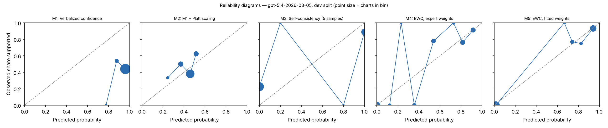

# EWC pilot report — gpt-5.4-2026-03-05 (gpt), dev split

Generated 2026-10-26T05:08:27. Charts: 140.

**Development split.** Fitted methods (M2, M5, M7, M8) are scored out-of-fold with C chosen on all of dev, so these numbers are mildly optimistic. They are for iteration, not for the paper.

## Calibration and discrimination — All charts

| Method | n | ECE (95% CI) | Brier | AUROC (95% CI) | Coverage at precision ≥ 0.95 |
|---|---|---|---|---|---|
| M1 Verbalized confidence | 140 | 0.506 (0.425–0.592) | 0.500 | 0.609 (0.511–0.702) | 0.00 |
| M2 M1 + Platt scaling | 140 | 0.094 (0.041–0.175) | 0.244 | 0.598 (0.500–0.693) | 0.00 |
| M3 Self-consistency (5 samples) | 140 | 0.197 (0.133–0.264) | 0.195 | 0.796 (0.728–0.862) | 0.00 |
| M4 EWC, expert weights | 140 | 0.116 (0.090–0.170) | 0.098 | 0.932 (0.887–0.969) | 0.00 |
| M5 EWC, fitted weights | 140 | 0.029 (0.023–0.073) | 0.052 | 0.962 (0.928–0.988) | 0.16 |
| M7 Ablation: no quote verification | 140 | 0.029 (0.023–0.073) | 0.052 | 0.962 (0.928–0.988) | 0.16 |
| M8 Ablation: two-way answers | 140 | 0.059 (0.027–0.116) | 0.095 | 0.917 (0.872–0.956) | 0.30 |

## Calibration and discrimination — Excluding charts flagged label_needs_review

| Method | n | ECE (95% CI) | Brier | AUROC (95% CI) | Coverage at precision ≥ 0.95 |
|---|---|---|---|---|---|
| M1 Verbalized confidence | 136 | 0.494 (0.411–0.579) | 0.488 | 0.609 (0.503–0.710) | 0.00 |
| M2 M1 + Platt scaling | 136 | 0.102 (0.042–0.186) | 0.246 | 0.601 (0.495–0.698) | 0.00 |
| M3 Self-consistency (5 samples) | 136 | 0.188 (0.125–0.260) | 0.186 | 0.808 (0.737–0.869) | 0.00 |
| M4 EWC, expert weights | 136 | 0.127 (0.095–0.172) | 0.079 | 0.966 (0.933–0.989) | 0.15 |
| M5 EWC, fitted weights | 136 | 0.041 (0.029–0.072) | 0.031 | 0.984 (0.963–0.998) | 0.35 |
| M7 Ablation: no quote verification | 136 | 0.041 (0.029–0.072) | 0.031 | 0.984 (0.963–0.998) | 0.35 |
| M8 Ablation: two-way answers | 136 | 0.066 (0.035–0.112) | 0.079 | 0.943 (0.905–0.971) | 0.32 |

## Decisions at operating thresholds (all charts)

Auto-accept threshold: the lowest score giving precision ≥ 0.95 on dev, applied unchanged to test. F0.5 weights precision over recall. Charts flagged for review are never auto-accepted. On dev the threshold is chosen on these same charts, so dev precision meets the target by construction.

| Method | Threshold | Precision | Recall | F0.5 | Accepted | Precision at 0.5 | Recall at 0.5 | F0.5 at 0.5 |
|---|---|---|---|---|---|---|---|---|
| M1 | n/a | n/a | 0.000 | n/a | 0.00 | 0.443 | 1.000 | 0.498 |
| M2 | n/a | n/a | 0.000 | n/a | 0.00 | 0.625 | 0.242 | 0.475 |
| M3 | n/a | n/a | 0.000 | n/a | 0.00 | 0.870 | 0.645 | 0.813 |
| M4 | n/a | n/a | 0.000 | n/a | 0.00 | 0.845 | 0.968 | 0.867 |
| M5 | 0.943 | 0.957 | 0.355 | 0.714 | 0.16 | 0.886 | 1.000 | 0.906 |
| M7 | 0.943 | 0.957 | 0.355 | 0.714 | 0.16 | 0.886 | 1.000 | 0.906 |
| M8 | 0.915 | 0.952 | 0.645 | 0.870 | 0.30 | 0.726 | 0.855 | 0.749 |

## Extraction quality against intended answers

After verification. Plain agreement is shown for reference only; answer types are imbalanced.

| Question | Macro-F1 | Recall yes | Recall no | Recall not documented | Precision yes | Precision no | Agreement | Macro-F1 before verification | n |
|---|---|---|---|---|---|---|---|---|---|
| G1 | 1.000 | 1.000 (130) | 1.000 (10) | n/a (0) | 1.000 | 1.000 | 1.000 | 1.000 | 140 |
| G2 | 1.000 | 1.000 (111) | 1.000 (17) | n/a (0) | 1.000 | 1.000 | 1.000 | 1.000 | 128 |
| Q1 | 0.971 | 1.000 (95) | n/a (0) | 0.889 (45) | 1.000 | 0.000 | 0.964 | 0.971 | 140 |
| Q2 | 0.813 | 1.000 (93) | 1.000 (7) | 0.750 (40) | 1.000 | 0.412 | 0.929 | 0.813 | 140 |
| Q3 | 0.971 | 0.962 (53) | 1.000 (14) | 1.000 (73) | 1.000 | 0.875 | 0.986 | 0.971 | 140 |
| Q4 | 0.574 | 1.000 (86) | n/a (0) | 0.080 (25) | 1.000 | 0.000 | 0.793 | 0.574 | 111 |

Recall columns show the number of intended answers of that type in parentheses.

Confusion matrices (rows = intended answer, columns = model answer after verification):

**G1**

| intended \ model | yes | no | not documented |
|---|---|---|---|
| yes | 130 | 0 | 0 |
| no | 0 | 10 | 0 |
| not_documented | 0 | 0 | 0 |

**G2**

| intended \ model | yes | no | not documented |
|---|---|---|---|
| yes | 111 | 0 | 0 |
| no | 0 | 17 | 0 |
| not_documented | 0 | 0 | 0 |

**Q1**

| intended \ model | yes | no | not documented |
|---|---|---|---|
| yes | 95 | 0 | 0 |
| no | 0 | 0 | 0 |
| not_documented | 0 | 5 | 40 |

**Q2**

| intended \ model | yes | no | not documented |
|---|---|---|---|
| yes | 93 | 0 | 0 |
| no | 0 | 7 | 0 |
| not_documented | 0 | 10 | 30 |

**Q3**

| intended \ model | yes | no | not documented |
|---|---|---|---|
| yes | 51 | 2 | 0 |
| no | 0 | 14 | 0 |
| not_documented | 0 | 0 | 73 |

**Q4**

| intended \ model | yes | no | not documented |
|---|---|---|---|
| yes | 86 | 0 | 0 |
| no | 0 | 0 | 0 |
| not_documented | 0 | 23 | 2 |

Ambiguous fields (two answers defensible), reported separately:

- G2: agreement 0.833, macro-F1 0.909 (n = 12)
- Q4: agreement 0.000, macro-F1 0.000 (n = 29)

## Faithfulness, review flags and reproducibility

- Yes/no answers whose quote failed verification: 0.000
- By question: G1 0.000 (0 of 140); G2 0.000 (0 of 130); Q1 0.000 (0 of 100); Q2 0.000 (0 of 110); Q3 0.000 (0 of 67); Q4 0.000 (0 of 138)
- Charts flagged for human review by the verification rule: 0
- Unparseable responses: 0
- Median per-chart score SD across extraction runs, M5: 0.000 (n = 140)
- Median per-chart SD of verbalized confidence across runs, M1: 0.008 (n = 140)

## Fitted weights (M5, fitted on dev)

| Feature | Weight |
|---|---|
| intercept | -0.462 |
| Q1_yes | -0.749 |
| Q1_no | 0.790 |
| Q2_yes | -0.764 |
| Q2_no | 0.000 |
| Q3_yes | 1.429 |
| Q3_no | -4.755 |
| Q4_yes | 3.027 |
| Q4_no | -3.170 |

C = 10.0; grid extended: False; still at grid edge: False; training charts: 101 (62 positive).

## Pre-registered checks

| Check | Result |
|---|---|
| H1 macro-F1 >= 0.90 and 'no' recall >= 0.90 on every question | False |
| H2 quote failures <= 5% | True |
| H3 M5 median SD <= 0.05 and below M1 | True |
| H4 M5 AUROC >= M2 AUROC - 0.02 and M5 ECE <= M2 ECE | True |
| H5 M5 beats each of M6, M7, M8 on ECE or AUROC | {'M6': False, 'M7': False, 'M8': True} |
| Kill criterion: M5 worse than M2 on both AUROC and ECE | not triggered |
| Kill criterion: a gate question below 0.90 macro-F1 or 'no' recall | not triggered |

## Usage

1400 extraction and verbal calls; 1,319,700 input tokens, 250,718 output tokens (M6 calls not included).
