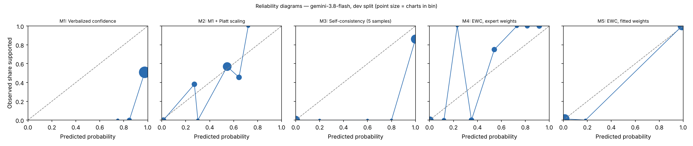

# EWC pilot report — gemini-3.8-flash (gemini), dev split

Generated 2026-10-27T01:48:47. Charts: 140.

**Development split.** Fitted methods (M2, M5, M7, M8) are scored out-of-fold with C chosen on all of dev, so these numbers are mildly optimistic. They are for iteration, not for the paper.

## Calibration and discrimination — All charts

| Method | n | ECE (95% CI) | Brier | AUROC (95% CI) | Coverage at precision ≥ 0.95 |
|---|---|---|---|---|---|
| M1 Verbalized confidence | 140 | 0.514 (0.435–0.595) | 0.492 | 0.710 (0.633–0.784) | 0.06 |
| M2 M1 + Platt scaling | 140 | 0.082 (0.049–0.157) | 0.203 | 0.698 (0.614–0.781) | 0.06 |
| M3 Self-consistency (5 samples) | 140 | 0.089 (0.046–0.136) | 0.083 | 0.936 (0.898–0.971) | 0.00 |
| M4 EWC, expert weights | 140 | 0.152 (0.118–0.189) | 0.070 | 0.983 (0.963–0.997) | 0.38 |
| M5 EWC, fitted weights | 140 | 0.008 (0.005–0.025) | 0.007 | 0.999 (0.995–1.000) | 0.45 |
| M6 Ablation: LLM computes score | 140 | 0.008 (0.008–0.023) | 0.006 | 0.999 (0.998–1.000) | 0.44 |
| M7 Ablation: no quote verification | 140 | 0.008 (0.005–0.025) | 0.007 | 0.999 (0.995–1.000) | 0.45 |
| M8 Ablation: two-way answers | 140 | 0.031 (0.015–0.077) | 0.071 | 0.959 (0.928–0.982) | 0.28 |

## Calibration and discrimination — Excluding charts flagged label_needs_review

| Method | n | ECE (95% CI) | Brier | AUROC (95% CI) | Coverage at precision ≥ 0.95 |
|---|---|---|---|---|---|
| M1 Verbalized confidence | 136 | 0.500 (0.418–0.584) | 0.479 | 0.712 (0.629–0.789) | 0.06 |
| M2 M1 + Platt scaling | 136 | 0.098 (0.054–0.172) | 0.202 | 0.703 (0.613–0.783) | 0.06 |
| M3 Self-consistency (5 samples) | 136 | 0.062 (0.025–0.106) | 0.056 | 0.959 (0.922–0.988) | 0.00 |
| M4 EWC, expert weights | 136 | 0.160 (0.125–0.194) | 0.066 | 0.987 (0.969–0.998) | 0.46 |
| M5 EWC, fitted weights | 136 | 0.007 (0.005–0.023) | 0.007 | 0.999 (0.996–1.000) | 0.47 |
| M6 Ablation: LLM computes score | 136 | 0.011 (0.008–0.024) | 0.006 | 1.000 (0.999–1.000) | 0.48 |
| M7 Ablation: no quote verification | 136 | 0.007 (0.005–0.023) | 0.007 | 0.999 (0.996–1.000) | 0.47 |
| M8 Ablation: two-way answers | 136 | 0.031 (0.015–0.079) | 0.073 | 0.957 (0.922–0.982) | 0.29 |

## Decisions at operating thresholds (all charts)

Auto-accept threshold: the lowest score giving precision ≥ 0.95 on dev, applied unchanged to test. F0.5 weights precision over recall. Charts flagged for review are never auto-accepted. On dev the threshold is chosen on these same charts, so dev precision meets the target by construction.

| Method | Threshold | Precision | Recall | F0.5 | Accepted | Precision at 0.5 | Recall at 0.5 | F0.5 at 0.5 |
|---|---|---|---|---|---|---|---|---|
| M1 | 1.000 | 1.000 | 0.129 | 0.426 | 0.06 | 0.443 | 1.000 | 0.498 |
| M2 | 0.699 | 1.000 | 0.129 | 0.426 | 0.06 | 0.574 | 0.871 | 0.616 |
| M3 | n/a | n/a | 0.000 | n/a | 0.00 | 0.827 | 1.000 | 0.856 |
| M4 | 0.550 | 1.000 | 0.855 | 0.967 | 0.38 | 0.923 | 0.968 | 0.932 |
| M5 | 0.183 | 0.968 | 0.984 | 0.971 | 0.45 | 1.000 | 0.984 | 0.997 |
| M6 | 0.982 | 1.000 | 0.984 | 0.997 | 0.44 | 1.000 | 0.984 | 0.997 |
| M7 | 0.183 | 0.968 | 0.984 | 0.971 | 0.45 | 1.000 | 0.984 | 0.997 |
| M8 | 0.978 | 1.000 | 0.629 | 0.894 | 0.28 | 0.813 | 0.984 | 0.843 |

## Extraction quality against intended answers

After verification. Plain agreement is shown for reference only; answer types are imbalanced.

| Question | Macro-F1 | Recall yes | Recall no | Recall not documented | Precision yes | Precision no | Agreement | Macro-F1 before verification | n |
|---|---|---|---|---|---|---|---|---|---|
| G1 | 1.000 | 1.000 (130) | 1.000 (10) | n/a (0) | 1.000 | 1.000 | 1.000 | 1.000 | 140 |
| G2 | 1.000 | 1.000 (111) | 1.000 (17) | n/a (0) | 1.000 | 1.000 | 1.000 | 1.000 | 128 |
| Q1 | 1.000 | 1.000 (95) | n/a (0) | 1.000 (45) | 1.000 | n/a | 1.000 | 1.000 | 140 |
| Q2 | 1.000 | 1.000 (93) | 1.000 (7) | 1.000 (40) | 1.000 | 1.000 | 1.000 | 1.000 | 140 |
| Q3 | 1.000 | 1.000 (53) | 1.000 (14) | 1.000 (73) | 1.000 | 1.000 | 1.000 | 1.000 | 140 |
| Q4 | 0.987 | 0.988 (86) | n/a (0) | 1.000 (25) | 1.000 | n/a | 0.991 | 0.987 | 111 |

Recall columns show the number of intended answers of that type in parentheses.

Confusion matrices (rows = intended answer, columns = model answer after verification):

**G1**

| intended \ model | yes | no | not documented |
|---|---|---|---|
| yes | 130 | 0 | 0 |
| no | 0 | 10 | 0 |
| not_documented | 0 | 0 | 0 |

**G2**

| intended \ model | yes | no | not documented |
|---|---|---|---|
| yes | 111 | 0 | 0 |
| no | 0 | 17 | 0 |
| not_documented | 0 | 0 | 0 |

**Q1**

| intended \ model | yes | no | not documented |
|---|---|---|---|
| yes | 95 | 0 | 0 |
| no | 0 | 0 | 0 |
| not_documented | 0 | 0 | 45 |

**Q2**

| intended \ model | yes | no | not documented |
|---|---|---|---|
| yes | 93 | 0 | 0 |
| no | 0 | 7 | 0 |
| not_documented | 0 | 0 | 40 |

**Q3**

| intended \ model | yes | no | not documented |
|---|---|---|---|
| yes | 53 | 0 | 0 |
| no | 0 | 14 | 0 |
| not_documented | 0 | 0 | 73 |

**Q4**

| intended \ model | yes | no | not documented |
|---|---|---|---|
| yes | 85 | 0 | 1 |
| no | 0 | 0 | 0 |
| not_documented | 0 | 0 | 25 |

Ambiguous fields (two answers defensible), reported separately:

- G2: agreement 1.000, macro-F1 1.000 (n = 12)
- Q4: agreement 0.621, macro-F1 0.766 (n = 29)

## Faithfulness, review flags and reproducibility

- Yes/no answers whose quote failed verification: 0.000
- By question: G1 0.000 (0 of 140); G2 0.000 (0 of 128); Q1 0.000 (0 of 95); Q2 0.000 (0 of 100); Q3 0.000 (0 of 67); Q4 0.000 (0 of 96)
- Charts flagged for human review by the verification rule: 0
- Unparseable responses: 0
- Median per-chart score SD across extraction runs, M5: 0.000 (n = 140)
- Median per-chart SD of verbalized confidence across runs, M1: 0.004 (n = 140)

## Fitted weights (M5, fitted on dev)

| Feature | Weight |
|---|---|
| intercept | -5.724 |
| Q1_yes | 1.573 |
| Q1_no | 0.000 |
| Q2_yes | -0.039 |
| Q2_no | 0.000 |
| Q3_yes | 2.494 |
| Q3_no | -7.988 |
| Q4_yes | 8.174 |
| Q4_no | 0.000 |

C = 31.622776601683793; grid extended: False; still at grid edge: False; training charts: 101 (62 positive).

## Pre-registered checks

| Check | Result |
|---|---|
| H1 macro-F1 >= 0.90 and 'no' recall >= 0.90 on every question | True |
| H2 quote failures <= 5% | True |
| H3 M5 median SD <= 0.05 and below M1 | True |
| H4 M5 AUROC >= M2 AUROC - 0.02 and M5 ECE <= M2 ECE | True |
| H5 M5 beats each of M6, M7, M8 on ECE or AUROC | {'M6': True, 'M7': False, 'M8': True} |
| Kill criterion: M5 worse than M2 on both AUROC and ECE | not triggered |
| Kill criterion: a gate question below 0.90 macro-F1 or 'no' recall | not triggered |

## Usage

1400 extraction and verbal calls; 1,476,210 input tokens, 1,340,129 output tokens (M6 calls not included).
