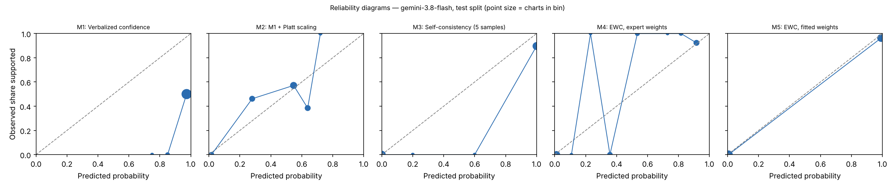

# EWC pilot report — gemini-3.8-flash (gemini), test split

Generated 2026-10-27T02:44:02. Charts: 60.

## Calibration and discrimination — All charts

| Method | n | ECE (95% CI) | Brier | AUROC (95% CI) | Coverage at precision ≥ 0.95 |
|---|---|---|---|---|---|
| M1 Verbalized confidence | 60 | 0.520 (0.398–0.642) | 0.498 | 0.669 (0.526–0.791) | 0.05 |
| M2 M1 + Platt scaling | 60 | 0.120 (0.063–0.240) | 0.216 | 0.669 (0.526–0.791) | 0.05 |
| M3 Self-consistency (5 samples) | 60 | 0.077 (0.023–0.143) | 0.063 | 0.956 (0.906–1.000) | 0.00 |
| M4 EWC, expert weights | 60 | 0.154 (0.114–0.218) | 0.076 | 0.966 (0.906–1.000) | 0.43 |
| M5 EWC, fitted weights | 60 | 0.016 (0.005–0.051) | 0.017 | 0.979 (0.928–1.000) | 0.45 |
| M6 Ablation: LLM computes score | 60 | 0.016 (0.005–0.051) | 0.017 | 0.978 (0.926–1.000) | 0.45 |
| M7 Ablation: no quote verification | 60 | 0.016 (0.005–0.051) | 0.017 | 0.979 (0.928–1.000) | 0.45 |
| M8 Ablation: two-way answers | 60 | 0.078 (0.030–0.149) | 0.081 | 0.933 (0.866–0.984) | 0.00 |

## Calibration and discrimination — Excluding charts flagged label_needs_review

| Method | n | ECE (95% CI) | Brier | AUROC (95% CI) | Coverage at precision ≥ 0.95 |
|---|---|---|---|---|---|
| M1 Verbalized confidence | 58 | 0.504 (0.385–0.625) | 0.483 | 0.676 (0.541–0.796) | 0.05 |
| M2 M1 + Platt scaling | 58 | 0.118 (0.065–0.243) | 0.215 | 0.676 (0.541–0.796) | 0.05 |
| M3 Self-consistency (5 samples) | 58 | 0.045 (0.007–0.093) | 0.031 | 0.984 (0.949–1.000) | 0.47 |
| M4 EWC, expert weights | 58 | 0.170 (0.123–0.219) | 0.063 | 0.989 (0.961–1.000) | 0.43 |
| M5 EWC, fitted weights | 58 | 0.007 (0.005–0.009) | 0.000 | 1.000 (1.000–1.000) | 0.45 |
| M6 Ablation: LLM computes score | 58 | 0.007 (0.005–0.009) | 0.000 | 1.000 (1.000–1.000) | 0.45 |
| M7 Ablation: no quote verification | 58 | 0.007 (0.005–0.009) | 0.000 | 1.000 (1.000–1.000) | 0.45 |
| M8 Ablation: two-way answers | 58 | 0.068 (0.023–0.137) | 0.067 | 0.953 (0.899–0.988) | 0.29 |

## Decisions at operating thresholds (all charts)

Auto-accept threshold: the lowest score giving precision ≥ 0.95 on dev, applied unchanged to test. F0.5 weights precision over recall. Charts flagged for review are never auto-accepted.

| Method | Threshold | Precision | Recall | F0.5 | Accepted | Precision at 0.5 | Recall at 0.5 | F0.5 at 0.5 |
|---|---|---|---|---|---|---|---|---|
| M1 | 1.000 | 1.000 | 0.115 | 0.395 | 0.05 | 0.433 | 1.000 | 0.489 |
| M2 | 0.699 | 1.000 | 0.115 | 0.395 | 0.05 | 0.541 | 0.769 | 0.575 |
| M3 | n/a | n/a | 0.000 | n/a | 0.00 | 0.839 | 1.000 | 0.867 |
| M4 | 0.550 | 0.955 | 0.808 | 0.921 | 0.37 | 0.962 | 0.962 | 0.962 |
| M5 | 0.183 | 0.963 | 1.000 | 0.970 | 0.45 | 0.963 | 1.000 | 0.970 |
| M6 | 0.982 | 0.963 | 1.000 | 0.970 | 0.45 | 0.963 | 1.000 | 0.970 |
| M7 | 0.183 | 0.963 | 1.000 | 0.970 | 0.45 | 0.963 | 1.000 | 0.970 |
| M8 | 0.978 | 0.944 | 0.654 | 0.867 | 0.30 | 0.788 | 1.000 | 0.823 |

## Extraction quality against intended answers

After verification. Plain agreement is shown for reference only; answer types are imbalanced.

| Question | Macro-F1 | Recall yes | Recall no | Recall not documented | Precision yes | Precision no | Agreement | Macro-F1 before verification | n |
|---|---|---|---|---|---|---|---|---|---|
| G1 | 1.000 | 1.000 (56) | 1.000 (4) | n/a (0) | 1.000 | 1.000 | 1.000 | 1.000 | 60 |
| G2 | 1.000 | 1.000 (47) | 1.000 (7) | n/a (0) | 1.000 | 1.000 | 1.000 | 1.000 | 54 |
| Q1 | 1.000 | 1.000 (38) | n/a (0) | 1.000 (22) | 1.000 | n/a | 1.000 | 1.000 | 60 |
| Q2 | 1.000 | 1.000 (46) | 1.000 (3) | 1.000 (11) | 1.000 | 1.000 | 1.000 | 1.000 | 60 |
| Q3 | 1.000 | 1.000 (19) | 1.000 (6) | 1.000 (35) | 1.000 | 1.000 | 1.000 | 1.000 | 60 |
| Q4 | 1.000 | 1.000 (36) | n/a (0) | 1.000 (11) | 1.000 | n/a | 1.000 | 1.000 | 47 |

Recall columns show the number of intended answers of that type in parentheses.

Confusion matrices (rows = intended answer, columns = model answer after verification):

**G1**

| intended \ model | yes | no | not documented |
|---|---|---|---|
| yes | 56 | 0 | 0 |
| no | 0 | 4 | 0 |
| not_documented | 0 | 0 | 0 |

**G2**

| intended \ model | yes | no | not documented |
|---|---|---|---|
| yes | 47 | 0 | 0 |
| no | 0 | 7 | 0 |
| not_documented | 0 | 0 | 0 |

**Q1**

| intended \ model | yes | no | not documented |
|---|---|---|---|
| yes | 38 | 0 | 0 |
| no | 0 | 0 | 0 |
| not_documented | 0 | 0 | 22 |

**Q2**

| intended \ model | yes | no | not documented |
|---|---|---|---|
| yes | 46 | 0 | 0 |
| no | 0 | 3 | 0 |
| not_documented | 0 | 0 | 11 |

**Q3**

| intended \ model | yes | no | not documented |
|---|---|---|---|
| yes | 19 | 0 | 0 |
| no | 0 | 6 | 0 |
| not_documented | 0 | 0 | 35 |

**Q4**

| intended \ model | yes | no | not documented |
|---|---|---|---|
| yes | 36 | 0 | 0 |
| no | 0 | 0 | 0 |
| not_documented | 0 | 0 | 11 |

Ambiguous fields (two answers defensible), reported separately:

- G2: agreement 1.000, macro-F1 1.000 (n = 6)
- Q4: agreement 0.538, macro-F1 0.700 (n = 13)

## Faithfulness, review flags and reproducibility

- Yes/no answers whose quote failed verification: 0.000
- By question: G1 0.000 (0 of 60); G2 0.000 (0 of 54); Q1 0.000 (0 of 38); Q2 0.000 (0 of 49); Q3 0.000 (0 of 25); Q4 0.000 (0 of 42)
- Charts flagged for human review by the verification rule: 0
- Unparseable responses: 0
- Median per-chart score SD across extraction runs, M5: 0.000 (n = 60)
- Median per-chart SD of verbalized confidence across runs, M1: 0.004 (n = 60)

## Fitted weights (M5, fitted on dev)

| Feature | Weight |
|---|---|
| intercept | -5.724 |
| Q1_yes | 1.573 |
| Q1_no | 0.000 |
| Q2_yes | -0.039 |
| Q2_no | 0.000 |
| Q3_yes | 2.494 |
| Q3_no | -7.988 |
| Q4_yes | 8.174 |
| Q4_no | 0.000 |

C = 31.622776601683793; grid extended: False; still at grid edge: False; training charts: 101 (62 positive).

## Pre-registered checks

| Check | Result |
|---|---|
| H1 macro-F1 >= 0.90 and 'no' recall >= 0.90 on every question | True |
| H2 quote failures <= 5% | True |
| H3 M5 median SD <= 0.05 and below M1 | True |
| H4 M5 AUROC >= M2 AUROC - 0.02 and M5 ECE <= M2 ECE | True |
| H5 M5 beats each of M6, M7, M8 on ECE or AUROC | {'M6': True, 'M7': False, 'M8': True} |
| Kill criterion: M5 worse than M2 on both AUROC and ECE | not triggered |
| Kill criterion: a gate question below 0.90 macro-F1 or 'no' recall | not triggered |

## Usage

600 extraction and verbal calls; 632,715 input tokens, 605,797 output tokens (M6 calls not included).
