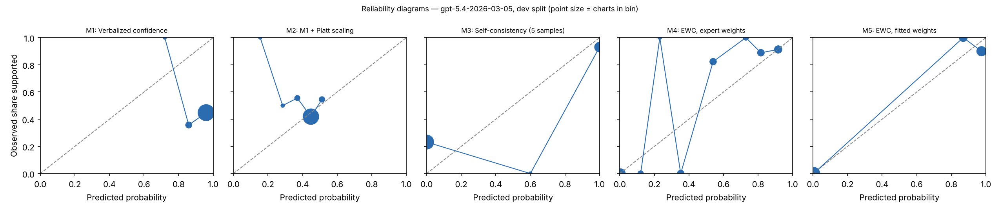

# EWC pilot report — gpt-5.4-2026-03-05 (gpt), dev split

Generated 2026-10-27T01:55:49. Charts: 140.

**Development split.** Fitted methods (M2, M5, M7, M8) are scored out-of-fold with C chosen on all of dev, so these numbers are mildly optimistic. They are for iteration, not for the paper.

## Calibration and discrimination — All charts

| Method | n | ECE (95% CI) | Brier | AUROC (95% CI) | Coverage at precision ≥ 0.95 |
|---|---|---|---|---|---|
| M1 Verbalized confidence | 140 | 0.509 (0.426–0.593) | 0.500 | 0.568 (0.467–0.661) | 0.00 |
| M2 M1 + Platt scaling | 140 | 0.048 (0.025–0.137) | 0.248 | 0.571 (0.471–0.669) | 0.00 |
| M3 Self-consistency (5 samples) | 140 | 0.187 (0.126–0.254) | 0.184 | 0.799 (0.730–0.862) | 0.00 |
| M4 EWC, expert weights | 140 | 0.129 (0.101–0.176) | 0.085 | 0.953 (0.912–0.984) | 0.00 |
| M5 EWC, fitted weights | 140 | 0.047 (0.025–0.078) | 0.030 | 0.969 (0.935–0.994) | 0.14 |
| M7 Ablation: no quote verification | 140 | 0.047 (0.025–0.078) | 0.030 | 0.969 (0.935–0.994) | 0.14 |
| M8 Ablation: two-way answers | 140 | 0.051 (0.022–0.102) | 0.087 | 0.927 (0.884–0.963) | 0.30 |

## Calibration and discrimination — Excluding charts flagged label_needs_review

| Method | n | ECE (95% CI) | Brier | AUROC (95% CI) | Coverage at precision ≥ 0.95 |
|---|---|---|---|---|---|
| M1 Verbalized confidence | 136 | 0.496 (0.411–0.581) | 0.489 | 0.571 (0.468–0.666) | 0.00 |
| M2 M1 + Platt scaling | 136 | 0.042 (0.024–0.134) | 0.250 | 0.570 (0.468–0.664) | 0.00 |
| M3 Self-consistency (5 samples) | 136 | 0.178 (0.116–0.244) | 0.174 | 0.811 (0.744–0.871) | 0.30 |
| M4 EWC, expert weights | 136 | 0.157 (0.122–0.191) | 0.065 | 0.987 (0.970–0.998) | 0.46 |
| M5 EWC, fitted weights | 136 | 0.033 (0.025–0.042) | 0.004 | 1.000 (1.000–1.000) | 0.48 |
| M7 Ablation: no quote verification | 136 | 0.033 (0.025–0.042) | 0.004 | 1.000 (1.000–1.000) | 0.48 |
| M8 Ablation: two-way answers | 136 | 0.057 (0.026–0.099) | 0.069 | 0.954 (0.920–0.979) | 0.32 |

## Decisions at operating thresholds (all charts)

Auto-accept threshold: the lowest score giving precision ≥ 0.95 on dev, applied unchanged to test. F0.5 weights precision over recall. Charts flagged for review are never auto-accepted. On dev the threshold is chosen on these same charts, so dev precision meets the target by construction.

| Method | Threshold | Precision | Recall | F0.5 | Accepted | Precision at 0.5 | Recall at 0.5 | F0.5 at 0.5 |
|---|---|---|---|---|---|---|---|---|
| M1 | n/a | n/a | 0.000 | n/a | 0.00 | 0.443 | 1.000 | 0.498 |
| M2 | n/a | n/a | 0.000 | n/a | 0.00 | 0.545 | 0.097 | 0.283 |
| M3 | n/a | n/a | 0.000 | n/a | 0.00 | 0.889 | 0.645 | 0.826 |
| M4 | n/a | n/a | 0.000 | n/a | 0.00 | 0.896 | 0.968 | 0.909 |
| M5 | 0.988 | 1.000 | 0.306 | 0.688 | 0.14 | 0.939 | 1.000 | 0.951 |
| M7 | 0.988 | 1.000 | 0.306 | 0.688 | 0.14 | 0.939 | 1.000 | 0.951 |
| M8 | 0.913 | 0.952 | 0.645 | 0.870 | 0.30 | 0.775 | 1.000 | 0.812 |

## Extraction quality against intended answers

After verification. Plain agreement is shown for reference only; answer types are imbalanced.

| Question | Macro-F1 | Recall yes | Recall no | Recall not documented | Precision yes | Precision no | Agreement | Macro-F1 before verification | n |
|---|---|---|---|---|---|---|---|---|---|
| G1 | 1.000 | 1.000 (130) | 1.000 (10) | n/a (0) | 1.000 | 1.000 | 1.000 | 1.000 | 140 |
| G2 | 1.000 | 1.000 (111) | 1.000 (17) | n/a (0) | 1.000 | 1.000 | 1.000 | 1.000 | 128 |
| Q1 | 1.000 | 1.000 (95) | n/a (0) | 1.000 (45) | 1.000 | n/a | 1.000 | 1.000 | 140 |
| Q2 | 0.827 | 1.000 (93) | 1.000 (7) | 0.775 (40) | 1.000 | 0.438 | 0.936 | 0.827 | 140 |
| Q3 | 0.985 | 0.981 (53) | 1.000 (14) | 1.000 (73) | 1.000 | 0.933 | 0.993 | 0.985 | 140 |
| Q4 | 1.000 | 1.000 (86) | n/a (0) | 1.000 (25) | 1.000 | n/a | 1.000 | 1.000 | 111 |

Recall columns show the number of intended answers of that type in parentheses.

Confusion matrices (rows = intended answer, columns = model answer after verification):

**G1**

| intended \ model | yes | no | not documented |
|---|---|---|---|
| yes | 130 | 0 | 0 |
| no | 0 | 10 | 0 |
| not_documented | 0 | 0 | 0 |

**G2**

| intended \ model | yes | no | not documented |
|---|---|---|---|
| yes | 111 | 0 | 0 |
| no | 0 | 17 | 0 |
| not_documented | 0 | 0 | 0 |

**Q1**

| intended \ model | yes | no | not documented |
|---|---|---|---|
| yes | 95 | 0 | 0 |
| no | 0 | 0 | 0 |
| not_documented | 0 | 0 | 45 |

**Q2**

| intended \ model | yes | no | not documented |
|---|---|---|---|
| yes | 93 | 0 | 0 |
| no | 0 | 7 | 0 |
| not_documented | 0 | 9 | 31 |

**Q3**

| intended \ model | yes | no | not documented |
|---|---|---|---|
| yes | 52 | 1 | 0 |
| no | 0 | 14 | 0 |
| not_documented | 0 | 0 | 73 |

**Q4**

| intended \ model | yes | no | not documented |
|---|---|---|---|
| yes | 86 | 0 | 0 |
| no | 0 | 0 | 0 |
| not_documented | 0 | 0 | 25 |

Ambiguous fields (two answers defensible), reported separately:

- G2: agreement 1.000, macro-F1 1.000 (n = 12)
- Q4: agreement 0.586, macro-F1 0.739 (n = 29)

## Faithfulness, review flags and reproducibility

- Yes/no answers whose quote failed verification: 0.000
- By question: G1 0.000 (0 of 140); G2 0.000 (0 of 128); Q1 0.000 (0 of 95); Q2 0.000 (0 of 109); Q3 0.000 (0 of 67); Q4 0.000 (0 of 98)
- Charts flagged for human review by the verification rule: 0
- Unparseable responses: 0
- Median per-chart score SD across extraction runs, M5: 0.000 (n = 140)
- Median per-chart SD of verbalized confidence across runs, M1: 0.007 (n = 140)

## Fitted weights (M5, fitted on dev)

| Feature | Weight |
|---|---|
| intercept | -2.427 |
| Q1_yes | -2.276 |
| Q1_no | 0.000 |
| Q2_yes | -2.492 |
| Q2_no | 0.000 |
| Q3_yes | 0.370 |
| Q3_no | -8.679 |
| Q4_yes | 9.233 |
| Q4_no | 0.000 |

C = 100.0; grid extended: False; still at grid edge: False; training charts: 101 (62 positive).

## Pre-registered checks

| Check | Result |
|---|---|
| H1 macro-F1 >= 0.90 and 'no' recall >= 0.90 on every question | False |
| H2 quote failures <= 5% | True |
| H3 M5 median SD <= 0.05 and below M1 | True |
| H4 M5 AUROC >= M2 AUROC - 0.02 and M5 ECE <= M2 ECE | True |
| H5 M5 beats each of M6, M7, M8 on ECE or AUROC | {'M6': False, 'M7': False, 'M8': True} |
| Kill criterion: M5 worse than M2 on both AUROC and ECE | not triggered |
| Kill criterion: a gate question below 0.90 macro-F1 or 'no' recall | not triggered |

## Usage

1400 extraction and verbal calls; 1,392,500 input tokens, 236,630 output tokens (M6 calls not included).
