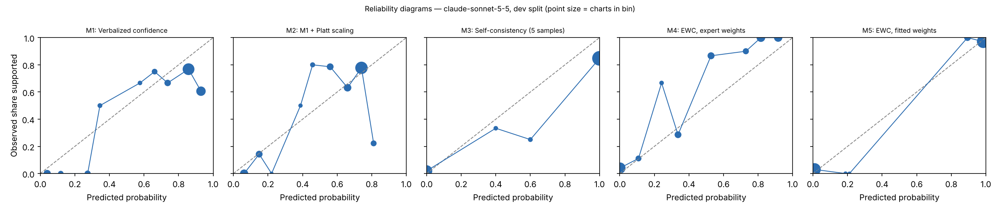

# EWC pilot report — claude-sonnet-5-5 (claude), dev split

Generated 2026-10-28T12:37:44. Charts: 150.

**Development split.** Fitted methods (M2, M5, M7, M8) are scored out-of-fold with C chosen on all of dev, so these numbers are mildly optimistic. They are for iteration, not for the paper.

## Calibration and discrimination — All charts

| Method | n | ECE (95% CI) | Brier | AUROC (95% CI) | Coverage at precision ≥ 0.95 |
|---|---|---|---|---|---|
| M1 Verbalized confidence | 150 | 0.149 (0.104–0.224) | 0.194 | 0.713 (0.622–0.807) | 0.00 |
| M2 M1 + Platt scaling | 150 | 0.100 (0.076–0.175) | 0.180 | 0.707 (0.614–0.801) | 0.00 |
| M3 Self-consistency (5 samples) | 150 | 0.111 (0.065–0.165) | 0.113 | 0.888 (0.836–0.937) | 0.00 |
| M4 EWC, expert weights | 150 | 0.117 (0.093–0.165) | 0.084 | 0.971 (0.945–0.990) | 0.50 |
| M5 EWC, fitted weights | 150 | 0.029 (0.015–0.058) | 0.027 | 0.977 (0.944–1.000) | 0.55 |
| M7 Ablation: no quote verification | 150 | 0.029 (0.015–0.058) | 0.027 | 0.977 (0.944–1.000) | 0.55 |
| M8 Ablation: two-way answers | 150 | 0.019 (0.012–0.056) | 0.039 | 0.958 (0.914–0.992) | 0.55 |

## Calibration and discrimination — Excluding charts flagged label_needs_review

| Method | n | ECE (95% CI) | Brier | AUROC (95% CI) | Coverage at precision ≥ 0.95 |
|---|---|---|---|---|---|
| M1 Verbalized confidence | 150 | 0.149 (0.104–0.224) | 0.194 | 0.713 (0.622–0.807) | 0.00 |
| M2 M1 + Platt scaling | 150 | 0.100 (0.076–0.175) | 0.180 | 0.707 (0.614–0.801) | 0.00 |
| M3 Self-consistency (5 samples) | 150 | 0.111 (0.065–0.165) | 0.113 | 0.888 (0.836–0.937) | 0.00 |
| M4 EWC, expert weights | 150 | 0.117 (0.093–0.165) | 0.084 | 0.971 (0.945–0.990) | 0.50 |
| M5 EWC, fitted weights | 150 | 0.029 (0.015–0.058) | 0.027 | 0.977 (0.944–1.000) | 0.55 |
| M7 Ablation: no quote verification | 150 | 0.029 (0.015–0.058) | 0.027 | 0.977 (0.944–1.000) | 0.55 |
| M8 Ablation: two-way answers | 150 | 0.019 (0.012–0.056) | 0.039 | 0.958 (0.914–0.992) | 0.55 |

## Decisions at operating thresholds (all charts)

Auto-accept threshold: the lowest score giving precision ≥ 0.95 on dev, applied unchanged to test. F0.5 weights precision over recall. Charts flagged for review are never auto-accepted. On dev the threshold is chosen on these same charts, so dev precision meets the target by construction.

| Method | Threshold | Precision | Recall | F0.5 | Accepted | Precision at 0.5 | Recall at 0.5 | F0.5 at 0.5 |
|---|---|---|---|---|---|---|---|---|
| M1 | n/a | n/a | 0.000 | n/a | 0.00 | 0.705 | 0.975 | 0.747 |
| M2 | n/a | n/a | 0.000 | n/a | 0.00 | 0.705 | 0.914 | 0.739 |
| M3 | n/a | n/a | 0.000 | n/a | 0.00 | 0.823 | 0.975 | 0.849 |
| M4 | 0.522 | 0.960 | 0.889 | 0.945 | 0.50 | 0.960 | 0.889 | 0.945 |
| M5 | 0.199 | 0.952 | 0.975 | 0.956 | 0.55 | 0.975 | 0.975 | 0.975 |
| M7 | 0.199 | 0.952 | 0.975 | 0.956 | 0.55 | 0.975 | 0.975 | 0.975 |
| M8 | 0.862 | 0.952 | 0.975 | 0.956 | 0.55 | 0.952 | 0.975 | 0.956 |

## Extraction quality against intended answers

After verification. Plain agreement is shown for reference only; answer types are imbalanced.

| Question | Macro-F1 | Recall yes | Recall no | Recall not documented | Precision yes | Precision no | Agreement | Macro-F1 before verification | n |
|---|---|---|---|---|---|---|---|---|---|
| G1 | 0.996 | 0.986 (141) | 1.000 (8) | n/a (0) | 1.000 | 1.000 | 0.987 | 0.996 | 149 |
| G2 | 0.996 | 0.984 (129) | 1.000 (7) | n/a (0) | 1.000 | 1.000 | 0.985 | 0.996 | 136 |
| R1 | 0.974 | 0.978 (137) | 0.923 (13) | n/a (0) | 1.000 | 1.000 | 0.973 | 0.974 | 150 |
| R2 | 0.891 | 0.965 (144) | 1.000 (6) | n/a (0) | 1.000 | 0.667 | 0.967 | 0.891 | 150 |
| Q1 | 0.976 | 0.983 (117) | n/a (0) | 1.000 (25) | 1.000 | n/a | 0.986 | 0.976 | 142 |
| Q2 | 0.815 | 0.919 (99) | 0.571 (7) | 1.000 (43) | 1.000 | 0.571 | 0.926 | 0.815 | 149 |
| Q3 | 1.000 | 1.000 (42) | 1.000 (2) | 1.000 (99) | 1.000 | 1.000 | 1.000 | 1.000 | 143 |
| Q4 | 0.958 | 0.970 (100) | n/a (0) | 1.000 (20) | 1.000 | n/a | 0.975 | 0.958 | 120 |

Recall columns show the number of intended answers of that type in parentheses.

Confusion matrices (rows = intended answer, columns = model answer after verification):

**G1**

| intended \ model | yes | no | not documented |
|---|---|---|---|
| yes | 139 | 0 | 2 |
| no | 0 | 8 | 0 |
| not_documented | 0 | 0 | 0 |

**G2**

| intended \ model | yes | no | not documented |
|---|---|---|---|
| yes | 127 | 0 | 2 |
| no | 0 | 7 | 0 |
| not_documented | 0 | 0 | 0 |

**R1**

| intended \ model | yes | no | not documented |
|---|---|---|---|
| yes | 134 | 0 | 3 |
| no | 0 | 12 | 1 |
| not_documented | 0 | 0 | 0 |

**R2**

| intended \ model | yes | no | not documented |
|---|---|---|---|
| yes | 139 | 3 | 2 |
| no | 0 | 6 | 0 |
| not_documented | 0 | 0 | 0 |

**Q1**

| intended \ model | yes | no | not documented |
|---|---|---|---|
| yes | 115 | 0 | 2 |
| no | 0 | 0 | 0 |
| not_documented | 0 | 0 | 25 |

**Q2**

| intended \ model | yes | no | not documented |
|---|---|---|---|
| yes | 91 | 3 | 5 |
| no | 0 | 4 | 3 |
| not_documented | 0 | 0 | 43 |

**Q3**

| intended \ model | yes | no | not documented |
|---|---|---|---|
| yes | 42 | 0 | 0 |
| no | 0 | 2 | 0 |
| not_documented | 0 | 0 | 99 |

**Q4**

| intended \ model | yes | no | not documented |
|---|---|---|---|
| yes | 97 | 0 | 3 |
| no | 0 | 0 | 0 |
| not_documented | 0 | 0 | 20 |

Ambiguous fields (two answers defensible), reported separately:

- G1: agreement 0.000, macro-F1 0.000 (n = 1)
- G2: agreement 0.929, macro-F1 0.955 (n = 14)
- Q1: agreement 1.000, macro-F1 1.000 (n = 8)
- Q2: agreement 1.000, macro-F1 1.000 (n = 1)
- Q3: agreement 1.000, macro-F1 1.000 (n = 7)
- Q4: agreement 0.700, macro-F1 0.691 (n = 30)

## Faithfulness, review flags and reproducibility

- Yes/no answers whose quote failed verification: 0.000
- By question: G1 0.000 (0 of 148); G2 0.000 (0 of 140); R1 0.000 (0 of 146); R2 0.000 (0 of 148); Q1 0.000 (0 of 123); Q2 0.000 (0 of 98); Q3 0.000 (0 of 51); Q4 0.000 (0 of 119)
- Charts flagged for human review by the verification rule: 0
- Unparseable responses: 13
- Median per-chart score SD across extraction runs, M5: 0.000 (n = 150)
- Median per-chart SD of verbalized confidence across runs, M1: 0.015 (n = 150)

## Fitted weights (M5, fitted on dev)

| Feature | Weight |
|---|---|
| intercept | -0.613 |
| Q1_yes | -4.879 |
| Q1_no | 0.000 |
| Q2_yes | 2.290 |
| Q2_no | 1.419 |
| Q3_yes | 0.106 |
| Q3_no | -6.730 |
| Q4_yes | 7.789 |
| Q4_no | 0.000 |

C = 31.622776601683793; grid extended: False; still at grid edge: False; training charts: 102 (80 positive).

## Pre-registered checks

| Check | Result |
|---|---|
| H1 macro-F1 >= 0.90 and 'no' recall >= 0.90 on every question | False |
| H2 quote failures <= 5% | True |
| H3 M5 median SD <= 0.05 and below M1 | True |
| H4 M5 AUROC >= M2 AUROC - 0.02 and M5 ECE <= M2 ECE | True |
| H5 M5 beats each of M6, M7, M8 on ECE or AUROC | {'M6': False, 'M7': False, 'M8': True} |
| Kill criterion: M5 worse than M2 on both AUROC and ECE | not triggered |
| Kill criterion: a gate question below 0.90 macro-F1 or 'no' recall | TRIGGERED |

## Usage

1500 extraction and verbal calls; 3,983,271 input tokens, 953,623 output tokens (M6 calls not included).
