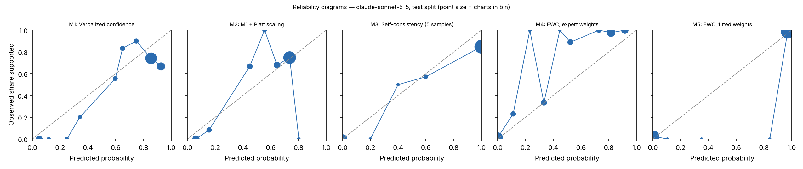

# EWC pilot report — claude-sonnet-5-5 (claude), test split

Generated 2026-10-28T12:59:54. Charts: 200.

## Calibration and discrimination — All charts

| Method | n | ECE (95% CI) | Brier | AUROC (95% CI) | Coverage at precision ≥ 0.95 |
|---|---|---|---|---|---|
| M1 Verbalized confidence | 200 | 0.143 (0.097–0.204) | 0.183 | 0.715 (0.627–0.794) | 0.00 |
| M2 M1 + Platt scaling | 200 | 0.067 (0.051–0.131) | 0.173 | 0.715 (0.627–0.794) | 0.00 |
| M3 Self-consistency (5 samples) | 200 | 0.104 (0.071–0.153) | 0.112 | 0.873 (0.822–0.920) | 0.00 |
| M4 EWC, expert weights | 200 | 0.128 (0.107–0.171) | 0.087 | 0.973 (0.950–0.991) | 0.56 |
| M5 EWC, fitted weights | 200 | 0.021 (0.007–0.042) | 0.024 | 0.987 (0.967–0.999) | 0.60 |
| M7 Ablation: no quote verification | 200 | 0.021 (0.007–0.042) | 0.024 | 0.987 (0.967–0.999) | 0.60 |
| M8 Ablation: two-way answers | 200 | 0.027 (0.013–0.054) | 0.036 | 0.983 (0.963–0.997) | 0.60 |

## Calibration and discrimination — Excluding charts flagged label_needs_review

| Method | n | ECE (95% CI) | Brier | AUROC (95% CI) | Coverage at precision ≥ 0.95 |
|---|---|---|---|---|---|
| M1 Verbalized confidence | 200 | 0.143 (0.097–0.204) | 0.183 | 0.715 (0.627–0.794) | 0.00 |
| M2 M1 + Platt scaling | 200 | 0.067 (0.051–0.131) | 0.173 | 0.715 (0.627–0.794) | 0.00 |
| M3 Self-consistency (5 samples) | 200 | 0.104 (0.071–0.153) | 0.112 | 0.873 (0.822–0.920) | 0.00 |
| M4 EWC, expert weights | 200 | 0.128 (0.107–0.171) | 0.087 | 0.973 (0.950–0.991) | 0.56 |
| M5 EWC, fitted weights | 200 | 0.021 (0.007–0.042) | 0.024 | 0.987 (0.967–0.999) | 0.60 |
| M7 Ablation: no quote verification | 200 | 0.021 (0.007–0.042) | 0.024 | 0.987 (0.967–0.999) | 0.60 |
| M8 Ablation: two-way answers | 200 | 0.027 (0.013–0.054) | 0.036 | 0.983 (0.963–0.997) | 0.60 |

## Decisions at operating thresholds (all charts)

Auto-accept threshold: the lowest score giving precision ≥ 0.95 on dev, applied unchanged to test. F0.5 weights precision over recall. Charts flagged for review are never auto-accepted.

| Method | Threshold | Precision | Recall | F0.5 | Accepted | Precision at 0.5 | Recall at 0.5 | F0.5 at 0.5 |
|---|---|---|---|---|---|---|---|---|
| M1 | n/a | n/a | 0.000 | n/a | 0.00 | 0.730 | 0.991 | 0.770 |
| M2 | n/a | n/a | 0.000 | n/a | 0.00 | 0.738 | 0.889 | 0.764 |
| M3 | n/a | n/a | 0.000 | n/a | 0.00 | 0.835 | 0.991 | 0.862 |
| M4 | 0.522 | 0.971 | 0.872 | 0.950 | 0.53 | 0.971 | 0.872 | 0.950 |
| M5 | 0.199 | 0.966 | 0.983 | 0.970 | 0.59 | 0.975 | 0.983 | 0.976 |
| M7 | 0.199 | 0.966 | 0.983 | 0.970 | 0.59 | 0.975 | 0.983 | 0.976 |
| M8 | 0.862 | 0.958 | 0.983 | 0.963 | 0.60 | 0.950 | 0.983 | 0.957 |

## Extraction quality against intended answers

After verification. Plain agreement is shown for reference only; answer types are imbalanced.

| Question | Macro-F1 | Recall yes | Recall no | Recall not documented | Precision yes | Precision no | Agreement | Macro-F1 before verification | n |
|---|---|---|---|---|---|---|---|---|---|
| G1 | 0.999 | 0.995 (187) | 1.000 (11) | n/a (0) | 1.000 | 1.000 | 0.995 | 0.999 | 198 |
| G2 | 1.000 | 1.000 (182) | 1.000 (10) | n/a (0) | 1.000 | 1.000 | 1.000 | 1.000 | 192 |
| R1 | 0.993 | 0.973 (183) | 1.000 (17) | n/a (0) | 1.000 | 1.000 | 0.975 | 0.993 | 200 |
| R2 | 0.866 | 0.963 (191) | 1.000 (9) | n/a (0) | 1.000 | 0.600 | 0.965 | 0.866 | 200 |
| Q1 | 1.000 | 1.000 (165) | n/a (0) | 1.000 (28) | 1.000 | n/a | 1.000 | 1.000 | 193 |
| Q2 | 0.847 | 0.922 (128) | 0.727 (11) | 0.949 (59) | 0.992 | 0.667 | 0.919 | 0.847 | 198 |
| Q3 | 0.984 | 0.940 (67) | 1.000 (3) | 1.000 (121) | 1.000 | 1.000 | 0.979 | 0.984 | 191 |
| Q4 | 0.984 | 0.993 (141) | n/a (0) | 1.000 (17) | 1.000 | n/a | 0.994 | 0.984 | 158 |

Recall columns show the number of intended answers of that type in parentheses.

Confusion matrices (rows = intended answer, columns = model answer after verification):

**G1**

| intended \ model | yes | no | not documented |
|---|---|---|---|
| yes | 186 | 0 | 1 |
| no | 0 | 11 | 0 |
| not_documented | 0 | 0 | 0 |

**G2**

| intended \ model | yes | no | not documented |
|---|---|---|---|
| yes | 182 | 0 | 0 |
| no | 0 | 10 | 0 |
| not_documented | 0 | 0 | 0 |

**R1**

| intended \ model | yes | no | not documented |
|---|---|---|---|
| yes | 178 | 0 | 5 |
| no | 0 | 17 | 0 |
| not_documented | 0 | 0 | 0 |

**R2**

| intended \ model | yes | no | not documented |
|---|---|---|---|
| yes | 184 | 6 | 1 |
| no | 0 | 9 | 0 |
| not_documented | 0 | 0 | 0 |

**Q1**

| intended \ model | yes | no | not documented |
|---|---|---|---|
| yes | 165 | 0 | 0 |
| no | 0 | 0 | 0 |
| not_documented | 0 | 0 | 28 |

**Q2**

| intended \ model | yes | no | not documented |
|---|---|---|---|
| yes | 118 | 2 | 8 |
| no | 0 | 8 | 3 |
| not_documented | 1 | 2 | 56 |

**Q3**

| intended \ model | yes | no | not documented |
|---|---|---|---|
| yes | 63 | 0 | 4 |
| no | 0 | 3 | 0 |
| not_documented | 0 | 0 | 121 |

**Q4**

| intended \ model | yes | no | not documented |
|---|---|---|---|
| yes | 140 | 0 | 1 |
| no | 0 | 0 | 0 |
| not_documented | 0 | 0 | 17 |

Ambiguous fields (two answers defensible), reported separately:

- G1: agreement 0.000, macro-F1 0.000 (n = 2)
- G2: agreement 1.000, macro-F1 1.000 (n = 8)
- Q1: agreement 1.000, macro-F1 1.000 (n = 7)
- Q2: agreement 1.000, macro-F1 1.000 (n = 2)
- Q3: agreement 1.000, macro-F1 1.000 (n = 9)
- Q4: agreement 0.738, macro-F1 0.725 (n = 42)

## Faithfulness, review flags and reproducibility

- Yes/no answers whose quote failed verification: 0.000
- By question: G1 0.000 (0 of 199); G2 0.000 (0 of 197); R1 0.000 (0 of 195); R2 0.000 (0 of 199); Q1 0.000 (0 of 172); Q2 0.000 (0 of 131); Q3 0.000 (0 of 75); Q4 0.000 (0 of 171)
- Charts flagged for human review by the verification rule: 0
- Unparseable responses: 8
- Median per-chart score SD across extraction runs, M5: 0.000 (n = 200)
- Median per-chart SD of verbalized confidence across runs, M1: 0.015 (n = 200)

## Fitted weights (M5, fitted on dev)

| Feature | Weight |
|---|---|
| intercept | -0.613 |
| Q1_yes | -4.879 |
| Q1_no | 0.000 |
| Q2_yes | 2.290 |
| Q2_no | 1.419 |
| Q3_yes | 0.106 |
| Q3_no | -6.730 |
| Q4_yes | 7.789 |
| Q4_no | 0.000 |

C = 31.622776601683793; grid extended: False; still at grid edge: False; training charts: 102 (80 positive).

## Pre-registered checks

| Check | Result |
|---|---|
| H1 macro-F1 >= 0.90 and 'no' recall >= 0.90 on every question | False |
| H2 quote failures <= 5% | True |
| H3 M5 median SD <= 0.05 and below M1 | True |
| H4 M5 AUROC >= M2 AUROC - 0.02 and M5 ECE <= M2 ECE | True |
| H5 M5 beats each of M6, M7, M8 on ECE or AUROC | {'M6': False, 'M7': False, 'M8': True} |
| Kill criterion: M5 worse than M2 on both AUROC and ECE | not triggered |
| Kill criterion: a gate question below 0.90 macro-F1 or 'no' recall | TRIGGERED |

## Usage

2000 extraction and verbal calls; 5,300,095 input tokens, 1,292,877 output tokens (M6 calls not included).
