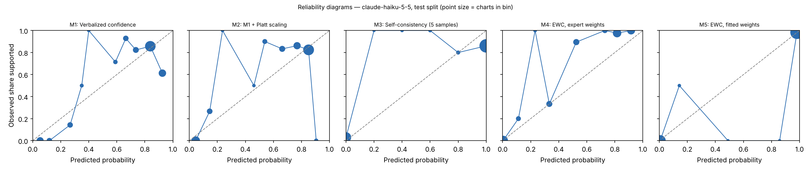

# EWC pilot report — claude-haiku-5-5 (claude_haiku), test split

Generated 2026-10-28T15:29:50. Charts: 200.

## Calibration and discrimination — All charts

| Method | n | ECE (95% CI) | Brier | AUROC (95% CI) | Coverage at precision ≥ 0.95 |
|---|---|---|---|---|---|
| M1 Verbalized confidence | 200 | 0.118 (0.091–0.176) | 0.147 | 0.772 (0.689–0.847) | 0.00 |
| M2 M1 + Platt scaling | 200 | 0.111 (0.081–0.165) | 0.149 | 0.772 (0.689–0.847) | 0.00 |
| M3 Self-consistency (5 samples) | 200 | 0.111 (0.073–0.157) | 0.108 | 0.879 (0.831–0.926) | 0.00 |
| M4 EWC, expert weights | 200 | 0.117 (0.099–0.157) | 0.075 | 0.982 (0.963–0.995) | 0.58 |
| M5 EWC, fitted weights | 200 | 0.014 (0.007–0.035) | 0.018 | 0.994 (0.981–1.000) | 0.61 |
| M7 Ablation: no quote verification | 200 | 0.010 (0.005–0.029) | 0.014 | 0.994 (0.982–1.000) | 0.61 |
| M8 Ablation: two-way answers | 200 | 0.014 (0.007–0.043) | 0.033 | 0.989 (0.976–0.998) | 0.61 |

## Calibration and discrimination — Excluding charts flagged label_needs_review

| Method | n | ECE (95% CI) | Brier | AUROC (95% CI) | Coverage at precision ≥ 0.95 |
|---|---|---|---|---|---|
| M1 Verbalized confidence | 200 | 0.118 (0.091–0.176) | 0.147 | 0.772 (0.689–0.847) | 0.00 |
| M2 M1 + Platt scaling | 200 | 0.111 (0.081–0.165) | 0.149 | 0.772 (0.689–0.847) | 0.00 |
| M3 Self-consistency (5 samples) | 200 | 0.111 (0.073–0.157) | 0.108 | 0.879 (0.831–0.926) | 0.00 |
| M4 EWC, expert weights | 200 | 0.117 (0.099–0.157) | 0.075 | 0.982 (0.963–0.995) | 0.58 |
| M5 EWC, fitted weights | 200 | 0.014 (0.007–0.035) | 0.018 | 0.994 (0.981–1.000) | 0.61 |
| M7 Ablation: no quote verification | 200 | 0.010 (0.005–0.029) | 0.014 | 0.994 (0.982–1.000) | 0.61 |
| M8 Ablation: two-way answers | 200 | 0.014 (0.007–0.043) | 0.033 | 0.989 (0.976–0.998) | 0.61 |

## Decisions at operating thresholds (all charts)

Auto-accept threshold: the lowest score giving precision ≥ 0.95 on dev, applied unchanged to test. F0.5 weights precision over recall. Charts flagged for review are never auto-accepted.

| Method | Threshold | Precision | Recall | F0.5 | Accepted | Precision at 0.5 | Recall at 0.5 | F0.5 at 0.5 |
|---|---|---|---|---|---|---|---|---|
| M1 | n/a | n/a | 0.000 | n/a | 0.00 | 0.799 | 0.949 | 0.825 |
| M2 | n/a | n/a | 0.000 | n/a | 0.00 | 0.803 | 0.940 | 0.827 |
| M3 | n/a | n/a | 0.000 | n/a | 0.00 | 0.862 | 0.957 | 0.879 |
| M4 | 0.332 | 0.966 | 0.957 | 0.964 | 0.58 | 0.972 | 0.906 | 0.958 |
| M5 | 0.182 | 0.967 | 0.991 | 0.972 | 0.60 | 0.975 | 0.991 | 0.978 |
| M7 | 0.182 | 0.967 | 1.000 | 0.973 | 0.60 | 0.975 | 1.000 | 0.980 |
| M8 | 0.228 | 0.943 | 0.991 | 0.952 | 0.61 | 0.943 | 0.991 | 0.952 |

## Extraction quality against intended answers

After verification. Plain agreement is shown for reference only; answer types are imbalanced.

| Question | Macro-F1 | Recall yes | Recall no | Recall not documented | Precision yes | Precision no | Agreement | Macro-F1 before verification | n |
|---|---|---|---|---|---|---|---|---|---|
| G1 | 1.000 | 1.000 (187) | 1.000 (11) | n/a (0) | 1.000 | 1.000 | 1.000 | 1.000 | 198 |
| G2 | 1.000 | 1.000 (182) | 1.000 (10) | n/a (0) | 1.000 | 1.000 | 1.000 | 1.000 | 192 |
| R1 | 0.994 | 0.978 (183) | 1.000 (17) | n/a (0) | 1.000 | 1.000 | 0.980 | 0.994 | 200 |
| R2 | 1.000 | 1.000 (191) | 1.000 (9) | n/a (0) | 1.000 | 1.000 | 1.000 | 1.000 | 200 |
| Q1 | 1.000 | 1.000 (165) | n/a (0) | 1.000 (28) | 1.000 | n/a | 1.000 | 1.000 | 193 |
| Q2 | 1.000 | 1.000 (128) | 1.000 (11) | 1.000 (59) | 1.000 | 1.000 | 1.000 | 1.000 | 198 |
| Q3 | 1.000 | 1.000 (67) | 1.000 (3) | 1.000 (121) | 1.000 | 1.000 | 1.000 | 1.000 | 191 |
| Q4 | 0.969 | 0.986 (141) | n/a (0) | 1.000 (17) | 1.000 | n/a | 0.987 | 1.000 | 158 |

Recall columns show the number of intended answers of that type in parentheses.

Confusion matrices (rows = intended answer, columns = model answer after verification):

**G1**

| intended \ model | yes | no | not documented |
|---|---|---|---|
| yes | 187 | 0 | 0 |
| no | 0 | 11 | 0 |
| not_documented | 0 | 0 | 0 |

**G2**

| intended \ model | yes | no | not documented |
|---|---|---|---|
| yes | 182 | 0 | 0 |
| no | 0 | 10 | 0 |
| not_documented | 0 | 0 | 0 |

**R1**

| intended \ model | yes | no | not documented |
|---|---|---|---|
| yes | 179 | 0 | 4 |
| no | 0 | 17 | 0 |
| not_documented | 0 | 0 | 0 |

**R2**

| intended \ model | yes | no | not documented |
|---|---|---|---|
| yes | 191 | 0 | 0 |
| no | 0 | 9 | 0 |
| not_documented | 0 | 0 | 0 |

**Q1**

| intended \ model | yes | no | not documented |
|---|---|---|---|
| yes | 165 | 0 | 0 |
| no | 0 | 0 | 0 |
| not_documented | 0 | 0 | 28 |

**Q2**

| intended \ model | yes | no | not documented |
|---|---|---|---|
| yes | 128 | 0 | 0 |
| no | 0 | 11 | 0 |
| not_documented | 0 | 0 | 59 |

**Q3**

| intended \ model | yes | no | not documented |
|---|---|---|---|
| yes | 67 | 0 | 0 |
| no | 0 | 3 | 0 |
| not_documented | 0 | 0 | 121 |

**Q4**

| intended \ model | yes | no | not documented |
|---|---|---|---|
| yes | 139 | 0 | 2 |
| no | 0 | 0 | 0 |
| not_documented | 0 | 0 | 17 |

Ambiguous fields (two answers defensible), reported separately:

- G1: agreement 0.000, macro-F1 0.000 (n = 2)
- G2: agreement 1.000, macro-F1 1.000 (n = 8)
- Q1: agreement 1.000, macro-F1 1.000 (n = 7)
- Q2: agreement 1.000, macro-F1 1.000 (n = 2)
- Q3: agreement 1.000, macro-F1 1.000 (n = 9)
- Q4: agreement 0.690, macro-F1 0.668 (n = 42)

## Faithfulness, review flags and reproducibility

- Yes/no answers whose quote failed verification: 0.001
- By question: G1 0.000 (0 of 200); G2 0.000 (0 of 197); R1 0.000 (0 of 196); R2 0.000 (0 of 200); Q1 0.000 (0 of 172); Q2 0.000 (0 of 139); Q3 0.000 (0 of 79); Q4 0.011 (2 of 174)
- Charts flagged for human review by the verification rule: 0
- Unparseable responses: 0
- Median per-chart score SD across extraction runs, M5: 0.000 (n = 200)
- Median per-chart SD of verbalized confidence across runs, M1: 0.034 (n = 200)

## Fitted weights (M5, fitted on dev)

| Feature | Weight |
|---|---|
| intercept | -0.040 |
| Q1_yes | -5.329 |
| Q1_no | 0.000 |
| Q2_yes | 1.840 |
| Q2_no | -0.348 |
| Q3_yes | 1.738 |
| Q3_no | -6.504 |
| Q4_yes | 7.833 |
| Q4_no | 0.000 |

C = 31.622776601683793; grid extended: False; still at grid edge: False; training charts: 101 (81 positive).

## Pre-registered checks

| Check | Result |
|---|---|
| H1 macro-F1 >= 0.90 and 'no' recall >= 0.90 on every question | True |
| H2 quote failures <= 5% | True |
| H3 M5 median SD <= 0.05 and below M1 | True |
| H4 M5 AUROC >= M2 AUROC - 0.02 and M5 ECE <= M2 ECE | True |
| H5 M5 beats each of M6, M7, M8 on ECE or AUROC | {'M6': False, 'M7': False, 'M8': True} |
| Kill criterion: M5 worse than M2 on both AUROC and ECE | not triggered |
| Kill criterion: a gate question below 0.90 macro-F1 or 'no' recall | not triggered |

## Usage

2000 extraction and verbal calls; 5,147,062 input tokens, 1,971,905 output tokens (M6 calls not included).
