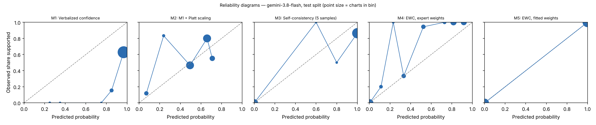

# EWC pilot report — gemini-3.8-flash (gemini), test split

Generated 2026-10-28T18:09:16. Charts: 200.

## Calibration and discrimination — All charts

| Method | n | ECE (95% CI) | Brier | AUROC (95% CI) | Coverage at precision ≥ 0.95 |
|---|---|---|---|---|---|
| M1 Verbalized confidence | 200 | 0.363 (0.296–0.430) | 0.361 | 0.647 (0.566–0.720) | 0.01 |
| M2 M1 + Platt scaling | 200 | 0.108 (0.064–0.173) | 0.221 | 0.647 (0.566–0.720) | 0.01 |
| M3 Self-consistency (5 samples) | 200 | 0.095 (0.058–0.136) | 0.094 | 0.890 (0.844–0.933) | 0.00 |
| M4 EWC, expert weights | 200 | 0.123 (0.106–0.160) | 0.071 | 0.990 (0.979–0.997) | 0.57 |
| M5 EWC, fitted weights | 200 | 0.002 (0.001–0.002) | 0.000 | 1.000 (1.000–1.000) | 0.61 |
| M7 Ablation: no quote verification | 200 | 0.002 (0.001–0.002) | 0.000 | 1.000 (1.000–1.000) | 0.61 |
| M8 Ablation: two-way answers | 200 | 0.002 (0.001–0.020) | 0.015 | 0.988 (0.971–1.000) | 0.61 |

## Calibration and discrimination — Excluding charts flagged label_needs_review

| Method | n | ECE (95% CI) | Brier | AUROC (95% CI) | Coverage at precision ≥ 0.95 |
|---|---|---|---|---|---|
| M1 Verbalized confidence | 200 | 0.363 (0.296–0.430) | 0.361 | 0.647 (0.566–0.720) | 0.01 |
| M2 M1 + Platt scaling | 200 | 0.108 (0.064–0.173) | 0.221 | 0.647 (0.566–0.720) | 0.01 |
| M3 Self-consistency (5 samples) | 200 | 0.095 (0.058–0.136) | 0.094 | 0.890 (0.844–0.933) | 0.00 |
| M4 EWC, expert weights | 200 | 0.123 (0.106–0.160) | 0.071 | 0.990 (0.979–0.997) | 0.57 |
| M5 EWC, fitted weights | 200 | 0.002 (0.001–0.002) | 0.000 | 1.000 (1.000–1.000) | 0.61 |
| M7 Ablation: no quote verification | 200 | 0.002 (0.001–0.002) | 0.000 | 1.000 (1.000–1.000) | 0.61 |
| M8 Ablation: two-way answers | 200 | 0.002 (0.001–0.020) | 0.015 | 0.988 (0.971–1.000) | 0.61 |

## Decisions at operating thresholds (all charts)

Auto-accept threshold: the lowest score giving precision ≥ 0.95 on dev, applied unchanged to test. F0.5 weights precision over recall. Charts flagged for review are never auto-accepted.

| Method | Threshold | Precision | Recall | F0.5 | Accepted | Precision at 0.5 | Recall at 0.5 | F0.5 at 0.5 |
|---|---|---|---|---|---|---|---|---|
| M1 | 1.000 | 1.000 | 0.009 | 0.041 | 0.01 | 0.594 | 1.000 | 0.646 |
| M2 | 0.736 | 1.000 | 0.009 | 0.041 | 0.01 | 0.731 | 0.650 | 0.713 |
| M3 | n/a | n/a | 0.000 | n/a | 0.00 | 0.860 | 1.000 | 0.885 |
| M4 | 0.332 | 0.982 | 0.957 | 0.977 | 0.57 | 0.991 | 0.906 | 0.972 |
| M5 | 0.009 | 0.959 | 1.000 | 0.967 | 0.61 | 1.000 | 1.000 | 1.000 |
| M7 | 0.009 | 0.959 | 1.000 | 0.967 | 0.61 | 1.000 | 1.000 | 1.000 |
| M8 | 0.013 | 0.967 | 1.000 | 0.973 | 0.60 | 0.975 | 1.000 | 0.980 |

## Extraction quality against intended answers

After verification. Plain agreement is shown for reference only; answer types are imbalanced.

| Question | Macro-F1 | Recall yes | Recall no | Recall not documented | Precision yes | Precision no | Agreement | Macro-F1 before verification | n |
|---|---|---|---|---|---|---|---|---|---|
| G1 | 1.000 | 1.000 (187) | 1.000 (11) | n/a (0) | 1.000 | 1.000 | 1.000 | 1.000 | 198 |
| G2 | 1.000 | 1.000 (182) | 1.000 (10) | n/a (0) | 1.000 | 1.000 | 1.000 | 1.000 | 192 |
| R1 | 0.979 | 0.973 (183) | 1.000 (17) | n/a (0) | 1.000 | 0.944 | 0.975 | 0.979 | 200 |
| R2 | 1.000 | 1.000 (191) | 1.000 (9) | n/a (0) | 1.000 | 1.000 | 1.000 | 1.000 | 200 |
| Q1 | 1.000 | 1.000 (165) | n/a (0) | 1.000 (28) | 1.000 | n/a | 1.000 | 1.000 | 193 |
| Q2 | 1.000 | 1.000 (128) | 1.000 (11) | 1.000 (59) | 1.000 | 1.000 | 1.000 | 1.000 | 198 |
| Q3 | 0.996 | 0.985 (67) | 1.000 (3) | 1.000 (121) | 1.000 | 1.000 | 0.995 | 0.996 | 191 |
| Q4 | 1.000 | 1.000 (141) | n/a (0) | 1.000 (17) | 1.000 | n/a | 1.000 | 1.000 | 158 |

Recall columns show the number of intended answers of that type in parentheses.

Confusion matrices (rows = intended answer, columns = model answer after verification):

**G1**

| intended \ model | yes | no | not documented |
|---|---|---|---|
| yes | 187 | 0 | 0 |
| no | 0 | 11 | 0 |
| not_documented | 0 | 0 | 0 |

**G2**

| intended \ model | yes | no | not documented |
|---|---|---|---|
| yes | 182 | 0 | 0 |
| no | 0 | 10 | 0 |
| not_documented | 0 | 0 | 0 |

**R1**

| intended \ model | yes | no | not documented |
|---|---|---|---|
| yes | 178 | 1 | 4 |
| no | 0 | 17 | 0 |
| not_documented | 0 | 0 | 0 |

**R2**

| intended \ model | yes | no | not documented |
|---|---|---|---|
| yes | 191 | 0 | 0 |
| no | 0 | 9 | 0 |
| not_documented | 0 | 0 | 0 |

**Q1**

| intended \ model | yes | no | not documented |
|---|---|---|---|
| yes | 165 | 0 | 0 |
| no | 0 | 0 | 0 |
| not_documented | 0 | 0 | 28 |

**Q2**

| intended \ model | yes | no | not documented |
|---|---|---|---|
| yes | 128 | 0 | 0 |
| no | 0 | 11 | 0 |
| not_documented | 0 | 0 | 59 |

**Q3**

| intended \ model | yes | no | not documented |
|---|---|---|---|
| yes | 66 | 0 | 1 |
| no | 0 | 3 | 0 |
| not_documented | 0 | 0 | 121 |

**Q4**

| intended \ model | yes | no | not documented |
|---|---|---|---|
| yes | 141 | 0 | 0 |
| no | 0 | 0 | 0 |
| not_documented | 0 | 0 | 17 |

Ambiguous fields (two answers defensible), reported separately:

- G1: agreement 0.500, macro-F1 0.667 (n = 2)
- G2: agreement 1.000, macro-F1 1.000 (n = 8)
- Q1: agreement 1.000, macro-F1 1.000 (n = 7)
- Q2: agreement 1.000, macro-F1 1.000 (n = 2)
- Q3: agreement 1.000, macro-F1 1.000 (n = 9)
- Q4: agreement 0.690, macro-F1 0.668 (n = 42)

## Faithfulness, review flags and reproducibility

- Yes/no answers whose quote failed verification: 0.001
- By question: G1 0.005 (1 of 200); G2 0.000 (0 of 197); R1 0.000 (0 of 196); R2 0.000 (0 of 200); Q1 0.000 (0 of 172); Q2 0.000 (0 of 139); Q3 0.000 (0 of 78); Q4 0.000 (0 of 174)
- Charts flagged for human review by the verification rule: 1
- Unparseable responses: 0
- Median per-chart score SD across extraction runs, M5: 0.000 (n = 200)
- Median per-chart SD of verbalized confidence across runs, M1: 0.004 (n = 200)

## Fitted weights (M5, fitted on dev)

| Feature | Weight |
|---|---|
| intercept | -3.084 |
| Q1_yes | -2.840 |
| Q1_no | 0.000 |
| Q2_yes | -0.143 |
| Q2_no | -1.472 |
| Q3_yes | 0.801 |
| Q3_no | -10.431 |
| Q4_yes | 12.538 |
| Q4_no | 0.000 |

C = 316.2277660168379; grid extended: False; still at grid edge: False; training charts: 101 (81 positive).

## Pre-registered checks

| Check | Result |
|---|---|
| H1 macro-F1 >= 0.90 and 'no' recall >= 0.90 on every question | True |
| H2 quote failures <= 5% | True |
| H3 M5 median SD <= 0.05 and below M1 | True |
| H4 M5 AUROC >= M2 AUROC - 0.02 and M5 ECE <= M2 ECE | True |
| H5 M5 beats each of M6, M7, M8 on ECE or AUROC | {'M6': False, 'M7': False, 'M8': True} |
| Kill criterion: M5 worse than M2 on both AUROC and ECE | not triggered |
| Kill criterion: a gate question below 0.90 macro-F1 or 'no' recall | not triggered |

## Usage

2000 extraction and verbal calls; 3,428,318 input tokens, 2,204,743 output tokens (M6 calls not included).
