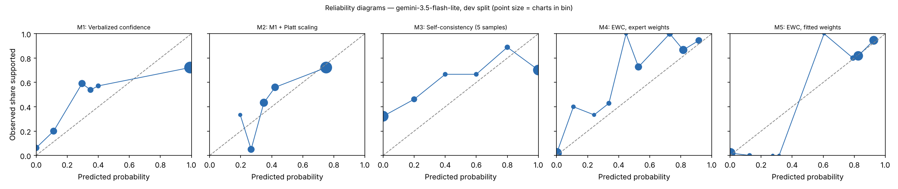

# EWC pilot report — gemini-3.5-flash-lite (gemini_lite), dev split

Generated 2026-10-28T18:11:10. Charts: 150.

**Development split.** Fitted methods (M2, M5, M7, M8) are scored out-of-fold with C chosen on all of dev, so these numbers are mildly optimistic. They are for iteration, not for the paper.

## Calibration and discrimination — All charts

| Method | n | ECE (95% CI) | Brier | AUROC (95% CI) | Coverage at precision ≥ 0.95 |
|---|---|---|---|---|---|
| M1 Verbalized confidence | 150 | 0.215 (0.152–0.291) | 0.246 | 0.742 (0.661–0.820) | 0.00 |
| M2 M1 + Platt scaling | 150 | 0.085 (0.051–0.161) | 0.209 | 0.711 (0.616–0.798) | 0.00 |
| M3 Self-consistency (5 samples) | 150 | 0.281 (0.219–0.363) | 0.295 | 0.692 (0.608–0.773) | 0.00 |
| M4 EWC, expert weights | 150 | 0.096 (0.068–0.155) | 0.110 | 0.921 (0.869–0.965) | 0.00 |
| M5 EWC, fitted weights | 150 | 0.025 (0.021–0.081) | 0.079 | 0.911 (0.854–0.959) | 0.00 |
| M7 Ablation: no quote verification | 150 | 0.061 (0.033–0.108) | 0.077 | 0.905 (0.845–0.957) | 0.00 |
| M8 Ablation: two-way answers | 150 | 0.039 (0.022–0.086) | 0.078 | 0.909 (0.853–0.956) | 0.00 |

## Calibration and discrimination — Excluding charts flagged label_needs_review

| Method | n | ECE (95% CI) | Brier | AUROC (95% CI) | Coverage at precision ≥ 0.95 |
|---|---|---|---|---|---|
| M1 Verbalized confidence | 150 | 0.215 (0.152–0.291) | 0.246 | 0.742 (0.661–0.820) | 0.00 |
| M2 M1 + Platt scaling | 150 | 0.085 (0.051–0.161) | 0.209 | 0.711 (0.616–0.798) | 0.00 |
| M3 Self-consistency (5 samples) | 150 | 0.281 (0.219–0.363) | 0.295 | 0.692 (0.608–0.773) | 0.00 |
| M4 EWC, expert weights | 150 | 0.096 (0.068–0.155) | 0.110 | 0.921 (0.869–0.965) | 0.00 |
| M5 EWC, fitted weights | 150 | 0.025 (0.021–0.081) | 0.079 | 0.911 (0.854–0.959) | 0.00 |
| M7 Ablation: no quote verification | 150 | 0.061 (0.033–0.108) | 0.077 | 0.905 (0.845–0.957) | 0.00 |
| M8 Ablation: two-way answers | 150 | 0.039 (0.022–0.086) | 0.078 | 0.909 (0.853–0.956) | 0.00 |

## Decisions at operating thresholds (all charts)

Auto-accept threshold: the lowest score giving precision ≥ 0.95 on dev, applied unchanged to test. F0.5 weights precision over recall. Charts flagged for review are never auto-accepted. On dev the threshold is chosen on these same charts, so dev precision meets the target by construction.

| Method | Threshold | Precision | Recall | F0.5 | Accepted | Precision at 0.5 | Recall at 0.5 | F0.5 at 0.5 |
|---|---|---|---|---|---|---|---|---|
| M1 | n/a | n/a | 0.000 | n/a | 0.00 | 0.722 | 0.642 | 0.705 |
| M2 | n/a | n/a | 0.000 | n/a | 0.00 | 0.722 | 0.642 | 0.705 |
| M3 | n/a | n/a | 0.000 | n/a | 0.00 | 0.722 | 0.642 | 0.705 |
| M4 | n/a | n/a | 0.000 | n/a | 0.00 | 0.867 | 0.889 | 0.872 |
| M5 | n/a | n/a | 0.000 | n/a | 0.00 | 0.870 | 0.988 | 0.891 |
| M7 | n/a | n/a | 0.000 | n/a | 0.00 | 0.870 | 0.988 | 0.891 |
| M8 | n/a | n/a | 0.000 | n/a | 0.00 | 0.870 | 0.988 | 0.891 |

## Extraction quality against intended answers

After verification. Plain agreement is shown for reference only; answer types are imbalanced.

| Question | Macro-F1 | Recall yes | Recall no | Recall not documented | Precision yes | Precision no | Agreement | Macro-F1 before verification | n |
|---|---|---|---|---|---|---|---|---|---|
| G1 | 0.996 | 0.986 (141) | 1.000 (8) | n/a (0) | 1.000 | 1.000 | 0.987 | 1.000 | 149 |
| G2 | 0.965 | 0.992 (129) | 1.000 (7) | n/a (0) | 1.000 | 0.875 | 0.993 | 0.965 | 136 |
| R1 | 0.980 | 0.993 (137) | 1.000 (13) | n/a (0) | 1.000 | 0.929 | 0.993 | 0.980 | 150 |
| R2 | 0.716 | 0.938 (144) | 0.667 (6) | n/a (0) | 0.985 | 0.364 | 0.927 | 0.719 | 150 |
| Q1 | 1.000 | 1.000 (117) | n/a (0) | 1.000 (25) | 1.000 | n/a | 1.000 | 1.000 | 142 |
| Q2 | 0.747 | 0.778 (99) | 0.857 (7) | 0.907 (43) | 0.987 | 0.462 | 0.819 | 0.747 | 149 |
| Q3 | 0.807 | 0.952 (42) | 0.500 (2) | 0.970 (99) | 0.952 | 0.500 | 0.958 | 0.807 | 143 |
| Q4 | 0.985 | 1.000 (100) | n/a (0) | 0.950 (20) | 0.990 | n/a | 0.992 | 0.985 | 120 |

Recall columns show the number of intended answers of that type in parentheses.

Confusion matrices (rows = intended answer, columns = model answer after verification):

**G1**

| intended \ model | yes | no | not documented |
|---|---|---|---|
| yes | 139 | 0 | 2 |
| no | 0 | 8 | 0 |
| not_documented | 0 | 0 | 0 |

**G2**

| intended \ model | yes | no | not documented |
|---|---|---|---|
| yes | 128 | 1 | 0 |
| no | 0 | 7 | 0 |
| not_documented | 0 | 0 | 0 |

**R1**

| intended \ model | yes | no | not documented |
|---|---|---|---|
| yes | 136 | 1 | 0 |
| no | 0 | 13 | 0 |
| not_documented | 0 | 0 | 0 |

**R2**

| intended \ model | yes | no | not documented |
|---|---|---|---|
| yes | 135 | 7 | 2 |
| no | 2 | 4 | 0 |
| not_documented | 0 | 0 | 0 |

**Q1**

| intended \ model | yes | no | not documented |
|---|---|---|---|
| yes | 117 | 0 | 0 |
| no | 0 | 0 | 0 |
| not_documented | 0 | 0 | 25 |

**Q2**

| intended \ model | yes | no | not documented |
|---|---|---|---|
| yes | 77 | 4 | 18 |
| no | 0 | 6 | 1 |
| not_documented | 1 | 3 | 39 |

**Q3**

| intended \ model | yes | no | not documented |
|---|---|---|---|
| yes | 40 | 0 | 2 |
| no | 0 | 1 | 1 |
| not_documented | 2 | 1 | 96 |

**Q4**

| intended \ model | yes | no | not documented |
|---|---|---|---|
| yes | 100 | 0 | 0 |
| no | 0 | 0 | 0 |
| not_documented | 1 | 0 | 19 |

Ambiguous fields (two answers defensible), reported separately:

- G1: agreement 0.000, macro-F1 0.000 (n = 1)
- G2: agreement 0.714, macro-F1 0.769 (n = 14)
- Q1: agreement 1.000, macro-F1 1.000 (n = 8)
- Q2: agreement 1.000, macro-F1 1.000 (n = 1)
- Q3: agreement 1.000, macro-F1 1.000 (n = 7)
- Q4: agreement 0.500, macro-F1 0.422 (n = 30)

## Faithfulness, review flags and reproducibility

- Yes/no answers whose quote failed verification: 0.006
- By question: G1 0.013 (2 of 150); G2 0.014 (2 of 147); R1 0.000 (0 of 150); R2 0.013 (2 of 150); Q1 0.000 (0 of 125); Q2 0.000 (0 of 91); Q3 0.000 (0 of 51); Q4 0.000 (0 of 129)
- Charts flagged for human review by the verification rule: 6
- Unparseable responses: 1
- Median per-chart score SD across extraction runs, M5: 0.000 (n = 150)
- Median per-chart SD of verbalized confidence across runs, M1: 0.000 (n = 150)

## Fitted weights (M5, fitted on dev)

| Feature | Weight |
|---|---|
| intercept | -2.154 |
| Q1_yes | -0.080 |
| Q1_no | 0.000 |
| Q2_yes | 0.098 |
| Q2_no | -0.662 |
| Q3_yes | 0.987 |
| Q3_no | -1.580 |
| Q4_yes | 3.716 |
| Q4_no | 0.000 |

C = 3.1622776601683795; grid extended: False; still at grid edge: False; training charts: 102 (80 positive).

## Pre-registered checks

| Check | Result |
|---|---|
| H1 macro-F1 >= 0.90 and 'no' recall >= 0.90 on every question | False |
| H2 quote failures <= 5% | True |
| H3 M5 median SD <= 0.05 and below M1 | False |
| H4 M5 AUROC >= M2 AUROC - 0.02 and M5 ECE <= M2 ECE | True |
| H5 M5 beats each of M6, M7, M8 on ECE or AUROC | {'M6': False, 'M7': True, 'M8': True} |
| Kill criterion: M5 worse than M2 on both AUROC and ECE | not triggered |
| Kill criterion: a gate question below 0.90 macro-F1 or 'no' recall | TRIGGERED |

## Usage

1500 extraction and verbal calls; 2,581,938 input tokens, 416,139 output tokens (M6 calls not included).
