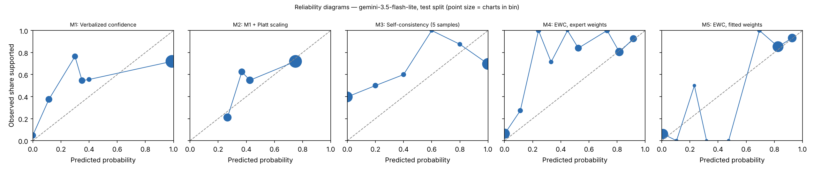

# EWC pilot report — gemini-3.5-flash-lite (gemini_lite), test split

Generated 2026-10-28T18:24:26. Charts: 200.

## Calibration and discrimination — All charts

| Method | n | ECE (95% CI) | Brier | AUROC (95% CI) | Coverage at precision ≥ 0.95 |
|---|---|---|---|---|---|
| M1 Verbalized confidence | 200 | 0.248 (0.188–0.310) | 0.266 | 0.692 (0.621–0.767) | 0.00 |
| M2 M1 + Platt scaling | 200 | 0.076 (0.039–0.143) | 0.214 | 0.692 (0.621–0.767) | 0.00 |
| M3 Self-consistency (5 samples) | 200 | 0.326 (0.266–0.388) | 0.327 | 0.650 (0.579–0.725) | 0.00 |
| M4 EWC, expert weights | 200 | 0.149 (0.119–0.210) | 0.155 | 0.879 (0.820–0.929) | 0.00 |
| M5 EWC, fitted weights | 200 | 0.050 (0.033–0.094) | 0.091 | 0.897 (0.843–0.944) | 0.00 |
| M7 Ablation: no quote verification | 200 | 0.041 (0.024–0.077) | 0.069 | 0.919 (0.867–0.962) | 0.00 |
| M8 Ablation: two-way answers | 200 | 0.029 (0.017–0.078) | 0.097 | 0.894 (0.839–0.941) | 0.00 |

## Calibration and discrimination — Excluding charts flagged label_needs_review

| Method | n | ECE (95% CI) | Brier | AUROC (95% CI) | Coverage at precision ≥ 0.95 |
|---|---|---|---|---|---|
| M1 Verbalized confidence | 200 | 0.248 (0.188–0.310) | 0.266 | 0.692 (0.621–0.767) | 0.00 |
| M2 M1 + Platt scaling | 200 | 0.076 (0.039–0.143) | 0.214 | 0.692 (0.621–0.767) | 0.00 |
| M3 Self-consistency (5 samples) | 200 | 0.326 (0.266–0.388) | 0.327 | 0.650 (0.579–0.725) | 0.00 |
| M4 EWC, expert weights | 200 | 0.149 (0.119–0.210) | 0.155 | 0.879 (0.820–0.929) | 0.00 |
| M5 EWC, fitted weights | 200 | 0.050 (0.033–0.094) | 0.091 | 0.897 (0.843–0.944) | 0.00 |
| M7 Ablation: no quote verification | 200 | 0.041 (0.024–0.077) | 0.069 | 0.919 (0.867–0.962) | 0.00 |
| M8 Ablation: two-way answers | 200 | 0.029 (0.017–0.078) | 0.097 | 0.894 (0.839–0.941) | 0.00 |

## Decisions at operating thresholds (all charts)

Auto-accept threshold: the lowest score giving precision ≥ 0.95 on dev, applied unchanged to test. F0.5 weights precision over recall. Charts flagged for review are never auto-accepted.

| Method | Threshold | Precision | Recall | F0.5 | Accepted | Precision at 0.5 | Recall at 0.5 | F0.5 at 0.5 |
|---|---|---|---|---|---|---|---|---|
| M1 | n/a | n/a | 0.000 | n/a | 0.00 | 0.720 | 0.658 | 0.706 |
| M2 | n/a | n/a | 0.000 | n/a | 0.00 | 0.720 | 0.658 | 0.706 |
| M3 | n/a | n/a | 0.000 | n/a | 0.00 | 0.728 | 0.641 | 0.709 |
| M4 | n/a | n/a | 0.000 | n/a | 0.00 | 0.868 | 0.786 | 0.850 |
| M5 | n/a | n/a | 0.000 | n/a | 0.00 | 0.889 | 0.957 | 0.902 |
| M7 | n/a | n/a | 0.000 | n/a | 0.00 | 0.890 | 0.966 | 0.904 |
| M8 | n/a | n/a | 0.000 | n/a | 0.00 | 0.868 | 0.957 | 0.885 |

## Extraction quality against intended answers

After verification. Plain agreement is shown for reference only; answer types are imbalanced.

| Question | Macro-F1 | Recall yes | Recall no | Recall not documented | Precision yes | Precision no | Agreement | Macro-F1 before verification | n |
|---|---|---|---|---|---|---|---|---|---|
| G1 | 0.995 | 0.979 (187) | 1.000 (11) | n/a (0) | 1.000 | 1.000 | 0.980 | 1.000 | 198 |
| G2 | 0.975 | 0.995 (182) | 1.000 (10) | n/a (0) | 1.000 | 0.909 | 0.995 | 0.975 | 192 |
| R1 | 0.969 | 0.989 (183) | 1.000 (17) | n/a (0) | 1.000 | 0.895 | 0.990 | 0.969 | 200 |
| R2 | 0.848 | 0.953 (191) | 1.000 (9) | n/a (0) | 1.000 | 0.562 | 0.955 | 0.851 | 200 |
| Q1 | 1.000 | 1.000 (165) | n/a (0) | 1.000 (28) | 1.000 | n/a | 1.000 | 1.000 | 193 |
| Q2 | 0.743 | 0.789 (128) | 0.818 (11) | 0.915 (59) | 0.981 | 0.391 | 0.828 | 0.743 | 198 |
| Q3 | 0.923 | 0.910 (67) | 1.000 (3) | 0.983 (121) | 0.984 | 0.750 | 0.958 | 0.923 | 191 |
| Q4 | 0.949 | 0.993 (141) | n/a (0) | 0.882 (17) | 0.986 | n/a | 0.981 | 0.965 | 158 |

Recall columns show the number of intended answers of that type in parentheses.

Confusion matrices (rows = intended answer, columns = model answer after verification):

**G1**

| intended \ model | yes | no | not documented |
|---|---|---|---|
| yes | 183 | 0 | 4 |
| no | 0 | 11 | 0 |
| not_documented | 0 | 0 | 0 |

**G2**

| intended \ model | yes | no | not documented |
|---|---|---|---|
| yes | 181 | 1 | 0 |
| no | 0 | 10 | 0 |
| not_documented | 0 | 0 | 0 |

**R1**

| intended \ model | yes | no | not documented |
|---|---|---|---|
| yes | 181 | 2 | 0 |
| no | 0 | 17 | 0 |
| not_documented | 0 | 0 | 0 |

**R2**

| intended \ model | yes | no | not documented |
|---|---|---|---|
| yes | 182 | 7 | 2 |
| no | 0 | 9 | 0 |
| not_documented | 0 | 0 | 0 |

**Q1**

| intended \ model | yes | no | not documented |
|---|---|---|---|
| yes | 165 | 0 | 0 |
| no | 0 | 0 | 0 |
| not_documented | 0 | 0 | 28 |

**Q2**

| intended \ model | yes | no | not documented |
|---|---|---|---|
| yes | 101 | 11 | 16 |
| no | 0 | 9 | 2 |
| not_documented | 2 | 3 | 54 |

**Q3**

| intended \ model | yes | no | not documented |
|---|---|---|---|
| yes | 61 | 0 | 6 |
| no | 0 | 3 | 0 |
| not_documented | 1 | 1 | 119 |

**Q4**

| intended \ model | yes | no | not documented |
|---|---|---|---|
| yes | 140 | 0 | 1 |
| no | 0 | 0 | 0 |
| not_documented | 2 | 0 | 15 |

Ambiguous fields (two answers defensible), reported separately:

- G1: agreement 0.500, macro-F1 0.667 (n = 2)
- G2: agreement 0.375, macro-F1 0.300 (n = 8)
- Q1: agreement 1.000, macro-F1 1.000 (n = 7)
- Q2: agreement 1.000, macro-F1 1.000 (n = 2)
- Q3: agreement 1.000, macro-F1 1.000 (n = 9)
- Q4: agreement 0.548, macro-F1 0.459 (n = 42)

## Faithfulness, review flags and reproducibility

- Yes/no answers whose quote failed verification: 0.005
- By question: G1 0.020 (4 of 200); G2 0.000 (0 of 200); R1 0.000 (0 of 200); R2 0.010 (2 of 200); Q1 0.000 (0 of 172); Q2 0.000 (0 of 126); Q3 0.000 (0 of 75); Q4 0.005 (1 of 182)
- Charts flagged for human review by the verification rule: 6
- Unparseable responses: 1
- Median per-chart score SD across extraction runs, M5: 0.000 (n = 200)
- Median per-chart SD of verbalized confidence across runs, M1: 0.000 (n = 200)

## Fitted weights (M5, fitted on dev)

| Feature | Weight |
|---|---|
| intercept | -2.154 |
| Q1_yes | -0.080 |
| Q1_no | 0.000 |
| Q2_yes | 0.098 |
| Q2_no | -0.662 |
| Q3_yes | 0.987 |
| Q3_no | -1.580 |
| Q4_yes | 3.716 |
| Q4_no | 0.000 |

C = 3.1622776601683795; grid extended: False; still at grid edge: False; training charts: 102 (80 positive).

## Pre-registered checks

| Check | Result |
|---|---|
| H1 macro-F1 >= 0.90 and 'no' recall >= 0.90 on every question | False |
| H2 quote failures <= 5% | True |
| H3 M5 median SD <= 0.05 and below M1 | False |
| H4 M5 AUROC >= M2 AUROC - 0.02 and M5 ECE <= M2 ECE | True |
| H5 M5 beats each of M6, M7, M8 on ECE or AUROC | {'M6': False, 'M7': False, 'M8': True} |
| Kill criterion: M5 worse than M2 on both AUROC and ECE | not triggered |
| Kill criterion: a gate question below 0.90 macro-F1 or 'no' recall | TRIGGERED |

## Usage

2000 extraction and verbal calls; 3,455,126 input tokens, 557,041 output tokens (M6 calls not included).
