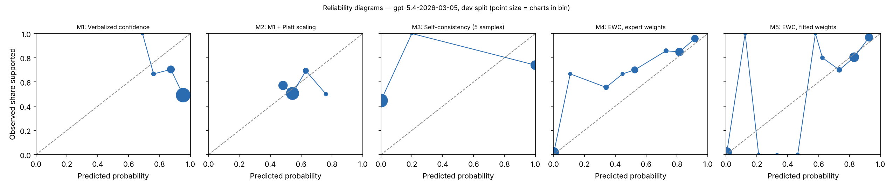

# EWC pilot report — gpt-5.4-2026-03-05 (gpt), dev split

Generated 2026-10-28T00:42:43. Charts: 150.

**Development split.** Fitted methods (M2, M5, M7, M8) are scored out-of-fold with C chosen on all of dev, so these numbers are mildly optimistic. They are for iteration, not for the paper.

## Calibration and discrimination — All charts

| Method | n | ECE (95% CI) | Brier | AUROC (95% CI) | Coverage at precision ≥ 0.95 |
|---|---|---|---|---|---|
| M1 Verbalized confidence | 150 | 0.394 (0.318–0.476) | 0.410 | 0.451 (0.358–0.541) | 0.00 |
| M2 M1 + Platt scaling | 150 | 0.061 (0.025–0.141) | 0.247 | 0.542 (0.453–0.638) | 0.00 |
| M3 Self-consistency (5 samples) | 150 | 0.392 (0.313–0.471) | 0.391 | 0.628 (0.557–0.696) | 0.00 |
| M4 EWC, expert weights | 150 | 0.077 (0.049–0.137) | 0.115 | 0.914 (0.864–0.960) | 0.16 |
| M5 EWC, fitted weights | 150 | 0.051 (0.037–0.108) | 0.096 | 0.919 (0.865–0.962) | 0.21 |
| M7 Ablation: no quote verification | 150 | 0.051 (0.037–0.108) | 0.096 | 0.919 (0.865–0.962) | 0.21 |
| M8 Ablation: two-way answers | 150 | 0.056 (0.038–0.112) | 0.100 | 0.910 (0.853–0.955) | 0.21 |

## Calibration and discrimination — Excluding charts flagged label_needs_review

| Method | n | ECE (95% CI) | Brier | AUROC (95% CI) | Coverage at precision ≥ 0.95 |
|---|---|---|---|---|---|
| M1 Verbalized confidence | 150 | 0.394 (0.318–0.476) | 0.410 | 0.451 (0.358–0.541) | 0.00 |
| M2 M1 + Platt scaling | 150 | 0.061 (0.025–0.141) | 0.247 | 0.542 (0.453–0.638) | 0.00 |
| M3 Self-consistency (5 samples) | 150 | 0.392 (0.313–0.471) | 0.391 | 0.628 (0.557–0.696) | 0.00 |
| M4 EWC, expert weights | 150 | 0.077 (0.049–0.137) | 0.115 | 0.914 (0.864–0.960) | 0.16 |
| M5 EWC, fitted weights | 150 | 0.051 (0.037–0.108) | 0.096 | 0.919 (0.865–0.962) | 0.21 |
| M7 Ablation: no quote verification | 150 | 0.051 (0.037–0.108) | 0.096 | 0.919 (0.865–0.962) | 0.21 |
| M8 Ablation: two-way answers | 150 | 0.056 (0.038–0.112) | 0.100 | 0.910 (0.853–0.955) | 0.21 |

## Decisions at operating thresholds (all charts)

Auto-accept threshold: the lowest score giving precision ≥ 0.95 on dev, applied unchanged to test. F0.5 weights precision over recall. Charts flagged for review are never auto-accepted. On dev the threshold is chosen on these same charts, so dev precision meets the target by construction.

| Method | Threshold | Precision | Recall | F0.5 | Accepted | Precision at 0.5 | Recall at 0.5 | F0.5 at 0.5 |
|---|---|---|---|---|---|---|---|---|
| M1 | n/a | n/a | 0.000 | n/a | 0.00 | 0.540 | 1.000 | 0.595 |
| M2 | n/a | n/a | 0.000 | n/a | 0.00 | 0.528 | 0.704 | 0.556 |
| M3 | n/a | n/a | 0.000 | n/a | 0.00 | 0.739 | 0.420 | 0.642 |
| M4 | 0.916 | 0.958 | 0.284 | 0.650 | 0.16 | 0.845 | 0.877 | 0.851 |
| M5 | 0.907 | 0.968 | 0.370 | 0.732 | 0.21 | 0.849 | 0.975 | 0.872 |
| M7 | 0.907 | 0.968 | 0.370 | 0.732 | 0.21 | 0.849 | 0.975 | 0.872 |
| M8 | 0.894 | 0.968 | 0.370 | 0.732 | 0.21 | 0.832 | 0.975 | 0.857 |

## Extraction quality against intended answers

After verification. Plain agreement is shown for reference only; answer types are imbalanced.

| Question | Macro-F1 | Recall yes | Recall no | Recall not documented | Precision yes | Precision no | Agreement | Macro-F1 before verification | n |
|---|---|---|---|---|---|---|---|---|---|
| G1 | 0.998 | 0.993 (141) | 1.000 (8) | n/a (0) | 1.000 | 1.000 | 0.993 | 0.998 | 149 |
| G2 | 0.998 | 0.992 (129) | 1.000 (7) | n/a (0) | 1.000 | 1.000 | 0.993 | 0.998 | 136 |
| R1 | 0.924 | 0.964 (137) | 1.000 (13) | n/a (0) | 1.000 | 0.765 | 0.967 | 0.924 | 150 |
| R2 | 0.866 | 0.965 (144) | 1.000 (6) | n/a (0) | 1.000 | 0.600 | 0.967 | 0.866 | 150 |
| Q1 | 0.988 | 0.991 (117) | n/a (0) | 1.000 (25) | 1.000 | n/a | 0.993 | 0.988 | 142 |
| Q2 | 0.769 | 0.919 (99) | 1.000 (7) | 0.744 (43) | 0.989 | 0.412 | 0.872 | 0.769 | 149 |
| Q3 | 0.874 | 0.952 (42) | 1.000 (2) | 0.980 (99) | 1.000 | 0.500 | 0.972 | 0.874 | 143 |
| Q4 | 0.920 | 0.990 (100) | n/a (0) | 0.800 (20) | 0.961 | n/a | 0.958 | 0.920 | 120 |

Recall columns show the number of intended answers of that type in parentheses.

Confusion matrices (rows = intended answer, columns = model answer after verification):

**G1**

| intended \ model | yes | no | not documented |
|---|---|---|---|
| yes | 140 | 0 | 1 |
| no | 0 | 8 | 0 |
| not_documented | 0 | 0 | 0 |

**G2**

| intended \ model | yes | no | not documented |
|---|---|---|---|
| yes | 128 | 0 | 1 |
| no | 0 | 7 | 0 |
| not_documented | 0 | 0 | 0 |

**R1**

| intended \ model | yes | no | not documented |
|---|---|---|---|
| yes | 132 | 4 | 1 |
| no | 0 | 13 | 0 |
| not_documented | 0 | 0 | 0 |

**R2**

| intended \ model | yes | no | not documented |
|---|---|---|---|
| yes | 139 | 4 | 1 |
| no | 0 | 6 | 0 |
| not_documented | 0 | 0 | 0 |

**Q1**

| intended \ model | yes | no | not documented |
|---|---|---|---|
| yes | 116 | 0 | 1 |
| no | 0 | 0 | 0 |
| not_documented | 0 | 0 | 25 |

**Q2**

| intended \ model | yes | no | not documented |
|---|---|---|---|
| yes | 91 | 0 | 8 |
| no | 0 | 7 | 0 |
| not_documented | 1 | 10 | 32 |

**Q3**

| intended \ model | yes | no | not documented |
|---|---|---|---|
| yes | 40 | 0 | 2 |
| no | 0 | 2 | 0 |
| not_documented | 0 | 2 | 97 |

**Q4**

| intended \ model | yes | no | not documented |
|---|---|---|---|
| yes | 99 | 0 | 1 |
| no | 0 | 0 | 0 |
| not_documented | 4 | 0 | 16 |

Ambiguous fields (two answers defensible), reported separately:

- G1: agreement 0.000, macro-F1 0.000 (n = 1)
- G2: agreement 0.643, macro-F1 0.692 (n = 14)
- Q1: agreement 1.000, macro-F1 1.000 (n = 8)
- Q2: agreement 0.000, macro-F1 0.000 (n = 1)
- Q3: agreement 1.000, macro-F1 1.000 (n = 7)
- Q4: agreement 0.667, macro-F1 0.661 (n = 30)

## Faithfulness, review flags and reproducibility

- Yes/no answers whose quote failed verification: 0.000
- By question: G1 0.000 (0 of 149); G2 0.000 (0 of 144); R1 0.000 (0 of 149); R2 0.000 (0 of 149); Q1 0.000 (0 of 124); Q2 0.000 (0 of 110); Q3 0.000 (0 of 51); Q4 0.000 (0 of 124)
- Charts flagged for human review by the verification rule: 0
- Unparseable responses: 4
- Median per-chart score SD across extraction runs, M5: 0.000 (n = 150)
- Median per-chart SD of verbalized confidence across runs, M1: 0.014 (n = 150)

## Fitted weights (M5, fitted on dev)

| Feature | Weight |
|---|---|
| intercept | -0.146 |
| Q1_yes | -1.287 |
| Q1_no | 0.000 |
| Q2_yes | 0.555 |
| Q2_no | -1.114 |
| Q3_yes | 0.899 |
| Q3_no | -2.192 |
| Q4_yes | 2.436 |
| Q4_no | 0.000 |

C = 3.1622776601683795; grid extended: False; still at grid edge: False; training charts: 103 (80 positive).

## Pre-registered checks

| Check | Result |
|---|---|
| H1 macro-F1 >= 0.90 and 'no' recall >= 0.90 on every question | False |
| H2 quote failures <= 5% | True |
| H3 M5 median SD <= 0.05 and below M1 | True |
| H4 M5 AUROC >= M2 AUROC - 0.02 and M5 ECE <= M2 ECE | True |
| H5 M5 beats each of M6, M7, M8 on ECE or AUROC | {'M6': False, 'M7': False, 'M8': True} |
| Kill criterion: M5 worse than M2 on both AUROC and ECE | not triggered |
| Kill criterion: a gate question below 0.90 macro-F1 or 'no' recall | TRIGGERED |

## Usage

1500 extraction and verbal calls; 2,409,546 input tokens, 346,887 output tokens (M6 calls not included).
