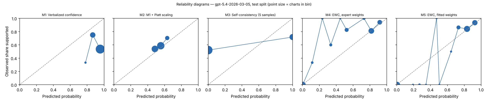

# EWC pilot report — gpt-5.4-2026-03-05 (gpt), test split

Generated 2026-10-28T03:22:52. Charts: 200.

## Calibration and discrimination — All charts

| Method | n | ECE (95% CI) | Brier | AUROC (95% CI) | Coverage at precision ≥ 0.95 |
|---|---|---|---|---|---|
| M1 Verbalized confidence | 200 | 0.346 (0.275–0.416) | 0.373 | 0.407 (0.329–0.482) | 0.00 |
| M2 M1 + Platt scaling | 200 | 0.046 (0.017–0.118) | 0.239 | 0.593 (0.518–0.671) | 0.01 |
| M3 Self-consistency (5 samples) | 200 | 0.445 (0.380–0.510) | 0.445 | 0.588 (0.527–0.649) | 0.00 |
| M4 EWC, expert weights | 200 | 0.093 (0.070–0.146) | 0.118 | 0.900 (0.846–0.944) | 0.00 |
| M5 EWC, fitted weights | 200 | 0.037 (0.027–0.081) | 0.078 | 0.926 (0.881–0.962) | 0.21 |
| M7 Ablation: no quote verification | 200 | 0.037 (0.027–0.081) | 0.078 | 0.926 (0.881–0.962) | 0.21 |
| M8 Ablation: two-way answers | 200 | 0.033 (0.022–0.074) | 0.084 | 0.921 (0.875–0.958) | 0.21 |

## Calibration and discrimination — Excluding charts flagged label_needs_review

| Method | n | ECE (95% CI) | Brier | AUROC (95% CI) | Coverage at precision ≥ 0.95 |
|---|---|---|---|---|---|
| M1 Verbalized confidence | 200 | 0.346 (0.275–0.416) | 0.373 | 0.407 (0.329–0.482) | 0.00 |
| M2 M1 + Platt scaling | 200 | 0.046 (0.017–0.118) | 0.239 | 0.593 (0.518–0.671) | 0.01 |
| M3 Self-consistency (5 samples) | 200 | 0.445 (0.380–0.510) | 0.445 | 0.588 (0.527–0.649) | 0.00 |
| M4 EWC, expert weights | 200 | 0.093 (0.070–0.146) | 0.118 | 0.900 (0.846–0.944) | 0.00 |
| M5 EWC, fitted weights | 200 | 0.037 (0.027–0.081) | 0.078 | 0.926 (0.881–0.962) | 0.21 |
| M7 Ablation: no quote verification | 200 | 0.037 (0.027–0.081) | 0.078 | 0.926 (0.881–0.962) | 0.21 |
| M8 Ablation: two-way answers | 200 | 0.033 (0.022–0.074) | 0.084 | 0.921 (0.875–0.958) | 0.21 |

## Decisions at operating thresholds (all charts)

Auto-accept threshold: the lowest score giving precision ≥ 0.95 on dev, applied unchanged to test. F0.5 weights precision over recall. Charts flagged for review are never auto-accepted.

| Method | Threshold | Precision | Recall | F0.5 | Accepted | Precision at 0.5 | Recall at 0.5 | F0.5 at 0.5 |
|---|---|---|---|---|---|---|---|---|
| M1 | n/a | n/a | 0.000 | n/a | 0.00 | 0.585 | 1.000 | 0.638 |
| M2 | n/a | n/a | 0.000 | n/a | 0.00 | 0.613 | 0.650 | 0.620 |
| M3 | n/a | n/a | 0.000 | n/a | 0.00 | 0.719 | 0.393 | 0.617 |
| M4 | 0.916 | 0.941 | 0.274 | 0.632 | 0.17 | 0.867 | 0.889 | 0.871 |
| M5 | 0.907 | 0.935 | 0.368 | 0.714 | 0.23 | 0.866 | 0.991 | 0.888 |
| M7 | 0.907 | 0.935 | 0.368 | 0.714 | 0.23 | 0.866 | 0.991 | 0.888 |
| M8 | 0.894 | 0.935 | 0.368 | 0.714 | 0.23 | 0.854 | 1.000 | 0.880 |

## Extraction quality against intended answers

After verification. Plain agreement is shown for reference only; answer types are imbalanced.

| Question | Macro-F1 | Recall yes | Recall no | Recall not documented | Precision yes | Precision no | Agreement | Macro-F1 before verification | n |
|---|---|---|---|---|---|---|---|---|---|
| G1 | 0.997 | 0.989 (187) | 1.000 (11) | n/a (0) | 1.000 | 1.000 | 0.990 | 0.997 | 198 |
| G2 | 0.997 | 0.989 (182) | 1.000 (10) | n/a (0) | 1.000 | 1.000 | 0.990 | 0.997 | 192 |
| R1 | 0.939 | 0.967 (183) | 1.000 (17) | n/a (0) | 1.000 | 0.810 | 0.970 | 0.939 | 200 |
| R2 | 0.895 | 0.979 (191) | 0.889 (9) | n/a (0) | 1.000 | 0.727 | 0.975 | 0.895 | 200 |
| Q1 | 0.980 | 0.988 (165) | n/a (0) | 1.000 (28) | 1.000 | n/a | 0.990 | 0.980 | 193 |
| Q2 | 0.857 | 0.945 (128) | 1.000 (11) | 0.831 (59) | 0.976 | 0.611 | 0.914 | 0.857 | 198 |
| Q3 | 0.972 | 0.896 (67) | 1.000 (3) | 1.000 (121) | 1.000 | 1.000 | 0.963 | 0.972 | 191 |
| Q4 | 0.930 | 0.993 (141) | n/a (0) | 0.824 (17) | 0.979 | n/a | 0.975 | 0.930 | 158 |

Recall columns show the number of intended answers of that type in parentheses.

Confusion matrices (rows = intended answer, columns = model answer after verification):

**G1**

| intended \ model | yes | no | not documented |
|---|---|---|---|
| yes | 185 | 0 | 2 |
| no | 0 | 11 | 0 |
| not_documented | 0 | 0 | 0 |

**G2**

| intended \ model | yes | no | not documented |
|---|---|---|---|
| yes | 180 | 0 | 2 |
| no | 0 | 10 | 0 |
| not_documented | 0 | 0 | 0 |

**R1**

| intended \ model | yes | no | not documented |
|---|---|---|---|
| yes | 177 | 4 | 2 |
| no | 0 | 17 | 0 |
| not_documented | 0 | 0 | 0 |

**R2**

| intended \ model | yes | no | not documented |
|---|---|---|---|
| yes | 187 | 3 | 1 |
| no | 0 | 8 | 1 |
| not_documented | 0 | 0 | 0 |

**Q1**

| intended \ model | yes | no | not documented |
|---|---|---|---|
| yes | 163 | 0 | 2 |
| no | 0 | 0 | 0 |
| not_documented | 0 | 0 | 28 |

**Q2**

| intended \ model | yes | no | not documented |
|---|---|---|---|
| yes | 121 | 0 | 7 |
| no | 0 | 11 | 0 |
| not_documented | 3 | 7 | 49 |

**Q3**

| intended \ model | yes | no | not documented |
|---|---|---|---|
| yes | 60 | 0 | 7 |
| no | 0 | 3 | 0 |
| not_documented | 0 | 0 | 121 |

**Q4**

| intended \ model | yes | no | not documented |
|---|---|---|---|
| yes | 140 | 0 | 1 |
| no | 0 | 0 | 0 |
| not_documented | 3 | 0 | 14 |

Ambiguous fields (two answers defensible), reported separately:

- G1: agreement 0.000, macro-F1 0.000 (n = 2)
- G2: agreement 0.375, macro-F1 0.273 (n = 8)
- Q1: agreement 1.000, macro-F1 1.000 (n = 7)
- Q2: agreement 0.500, macro-F1 0.667 (n = 2)
- Q3: agreement 1.000, macro-F1 1.000 (n = 9)
- Q4: agreement 0.619, macro-F1 0.571 (n = 42)

## Faithfulness, review flags and reproducibility

- Yes/no answers whose quote failed verification: 0.000
- By question: G1 0.000 (0 of 198); G2 0.000 (0 of 198); R1 0.000 (0 of 198); R2 0.000 (0 of 198); Q1 0.000 (0 of 170); Q2 0.000 (0 of 143); Q3 0.000 (0 of 72); Q4 0.000 (0 of 179)
- Charts flagged for human review by the verification rule: 0
- Unparseable responses: 5
- Median per-chart score SD across extraction runs, M5: 0.000 (n = 200)
- Median per-chart SD of verbalized confidence across runs, M1: 0.012 (n = 200)

## Fitted weights (M5, fitted on dev)

| Feature | Weight |
|---|---|
| intercept | -0.146 |
| Q1_yes | -1.287 |
| Q1_no | 0.000 |
| Q2_yes | 0.555 |
| Q2_no | -1.114 |
| Q3_yes | 0.899 |
| Q3_no | -2.192 |
| Q4_yes | 2.436 |
| Q4_no | 0.000 |

C = 3.1622776601683795; grid extended: False; still at grid edge: False; training charts: 103 (80 positive).

## Pre-registered checks

| Check | Result |
|---|---|
| H1 macro-F1 >= 0.90 and 'no' recall >= 0.90 on every question | False |
| H2 quote failures <= 5% | True |
| H3 M5 median SD <= 0.05 and below M1 | True |
| H4 M5 AUROC >= M2 AUROC - 0.02 and M5 ECE <= M2 ECE | True |
| H5 M5 beats each of M6, M7, M8 on ECE or AUROC | {'M6': False, 'M7': False, 'M8': True} |
| Kill criterion: M5 worse than M2 on both AUROC and ECE | not triggered |
| Kill criterion: a gate question below 0.90 macro-F1 or 'no' recall | TRIGGERED |

## Usage

2000 extraction and verbal calls; 3,224,404 input tokens, 465,917 output tokens (M6 calls not included).
